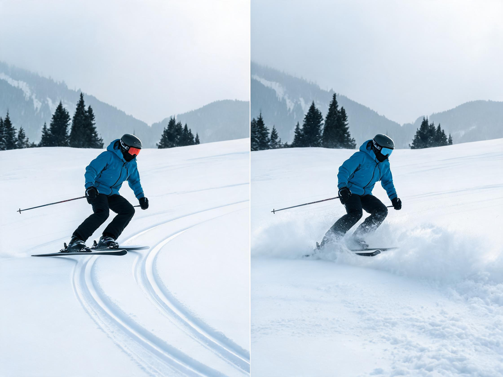
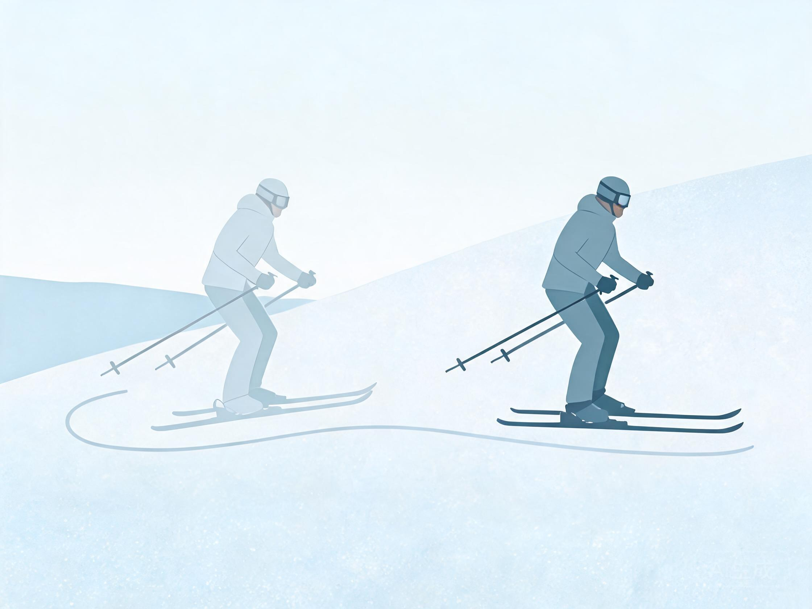
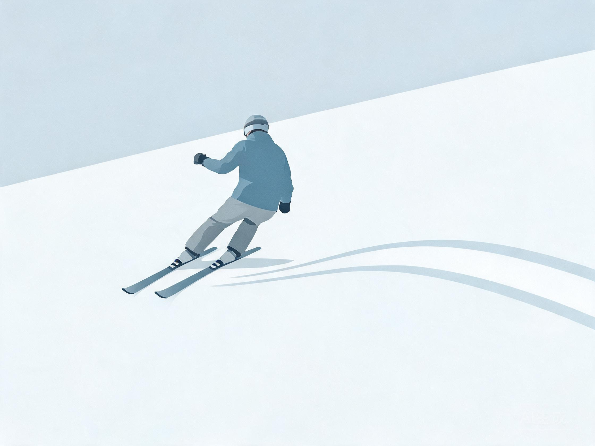
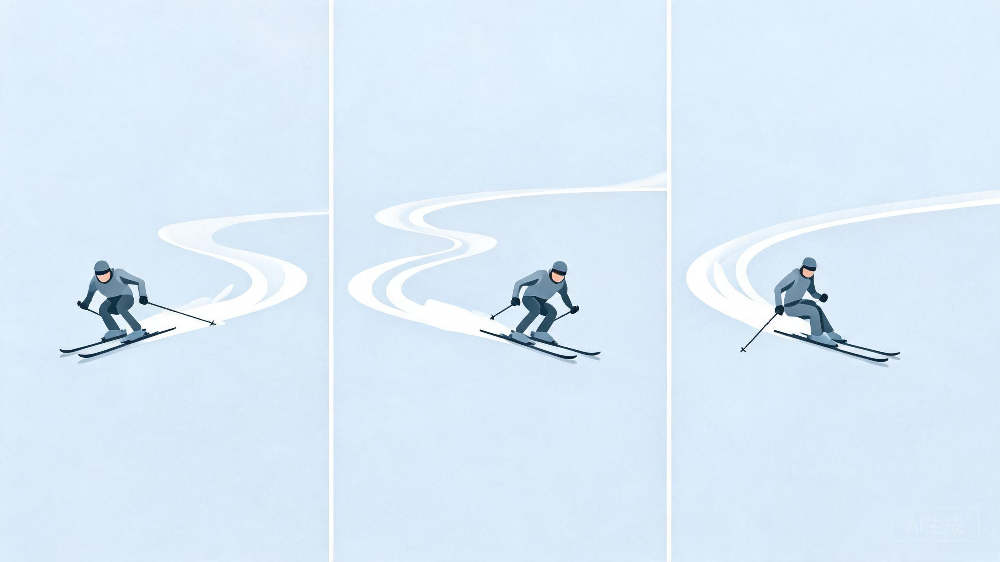
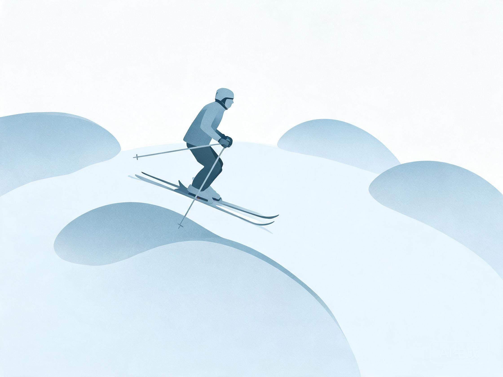

# 双板技术体系

> 教练口吻：温柔、平和、不评判；一次只改一件事。详见 `persona.md`。

## 人话速查

- 双板像两条腿各走各的，转弯靠"把板子侧过来切雪"。
- 新手就三件事：会停（犁式）、会转（犁式转弯）、会并（平行）。
- 刻滑记住一句：用边刃"划"，不是用板底"蹭"。
- 总觉得要摔，多半是重量压在脚后跟；把肚子往山下送一点。

*示意图：板头靠近、板尾打开，像一个"八"字*

*示意图：左边留下细线是刻滑，右边雪花四溅是搓雪*

看视频：PSIA-AASI 入门系列 https://thesnowpros.org/learn-to-ski-or-snowboard/ ；动作库 https://psia-c.org/education/alpine/ （先看 basic parallel、railroad tracks）。

## 一、PSIA 五大基本要素（Alpine Skiing Fundamentals）

诊断动作时按这五条逐项对照，能把"感觉不对"翻译成可练的指标：

1. 控制身体重心与支撑面的关系，让压力沿雪板长度分布
2. 控制压力从一只板到另一只板，并把压力导向山下板（外侧板）
3. 通过倾倒（inclination）与反弓（angulation）控制立刃角
4. 用腿部旋转控制雪板转向，与上身分离
5. 通过与雪的互动调节压力大小

来源：[S10][S11]

## 二、学习序列

1. **穿脱与行走**：雪板穿脱、平地行走、摔倒后起身。
2. **基本站姿**：膝踝微屈，重心在脚掌中部，双手前伸持杖。
3. **犁式刹车（snowplow / wedge）**：板尾分开，板头靠近，用内刃刮雪。
4. **犁式转弯**：重心移向山下板，板子自然转向；上山方向逐步加长。
5. **半犁式（stem christie）**：山上板收平行，过渡到平行转弯。
6. **平行转弯（parallel）**：双板全程平行，腿部旋转 + 立刃。
7. **动态平行 / 短弯**：节奏加快，利用反弹与吸收。
8. **卡宾（carving）**：纯刃刻雪，雪面留细线；大弯 → 中弯 → 小弯。
9. **蘑菇（mogul）**：吸收地形、点杖、膝盖弹簧。
10. **野雪与登山**：见 `discipline-big-mountain.md`。

*示意图：山上板从犁式收回，与山下板并成平行*

*示意图：双板全程平行，上身朝山下，只让腿转*

*示意图：连续小弯，点杖、换刃、再点杖*

*示意图：到包顶屈膝吸收，上身保持稳定*

## 三、阶段要点与纠错

| 阶段 | 关键感觉 | 常见错误 | 纠正练习 |
|---|---|---|---|
| 犁式 | 板尾推开、内刃刮雪 | 膝盖内扣、重心后坐 | 双手前压、慢速"推墙" |
| 犁式转弯 | 山下板承重 | 上身先倒、山上板拖 | 双手扶膝，只动下肢 |
| 平行 | 双板同步、腿部旋转 | 蹬雪尾、上下身一起转 | 扶髋滑行、窄道小弯 |
| 卡宾 | 刃线干净、离心力支撑 | 立刃不够、板尾搓雪 | 大半径横切、听刃声 |
| 蘑菇 | 膝盖吸收、点杖节奏 | 身体后坐、板头扎雪 | 小地形吸收练习、慢速跟节奏 |

## 四、五大要素对应的诊断话术

- 重心靠后 → 第 1 条：重心未沿板长前移
- 只有山下板承重但上身歪 → 第 2 条 + 第 3 条
- 转弯时肩膀先动 → 第 4 条：旋转未与上身分离
- 雪板"打滑" → 第 5 条：压力调节不足或立刃角不够

## 五、装备关联

板长、腰宽、半径、靴 flex、固定器 DIN 见 `knowledge-gear.md`。新手建议偏软靴 + 容错型全山板；竞技板与高 flex 靴不适合初学者。

## 六、安全

- 头盔全程；双板新手常见膝内侧韧带伤，摔倒时不要用手撑、不要强行扭膝。
- 固定器 DIN 必须由专业店按 ISO 11088 调整，不自行调高。
- 陡坡、冰面、野雪先评估再滑。

## 来源

- [S10] PSIA-AASI Alpine Certification — https://thesnowpros.org/get-certified/alpine/
- [S11] PSIA Alpine Skiing Technical Skills Performance Guide — https://thesnowpros.org/wp-content/uploads/2025/01/alpine-ski-performance_guide-jan24.pdf
- [S12] PSIA Alpine Certification Standards — https://thesnowpros.org/wp-content/uploads/2024/12/PSIA_Alpine_Certification_Standards1022v3.pdf
- [S7] 国家体育总局《双板滑雪大众技术等级考试实施细则》 — https://www.sport.gov.cn/dyzx/n5169/c946674/part/592589.pdf
- [S23] ISO 11088:2023 高山滑雪板/靴/固定器系统装配与检查 — https://www.iso.org/standard/84084.html
