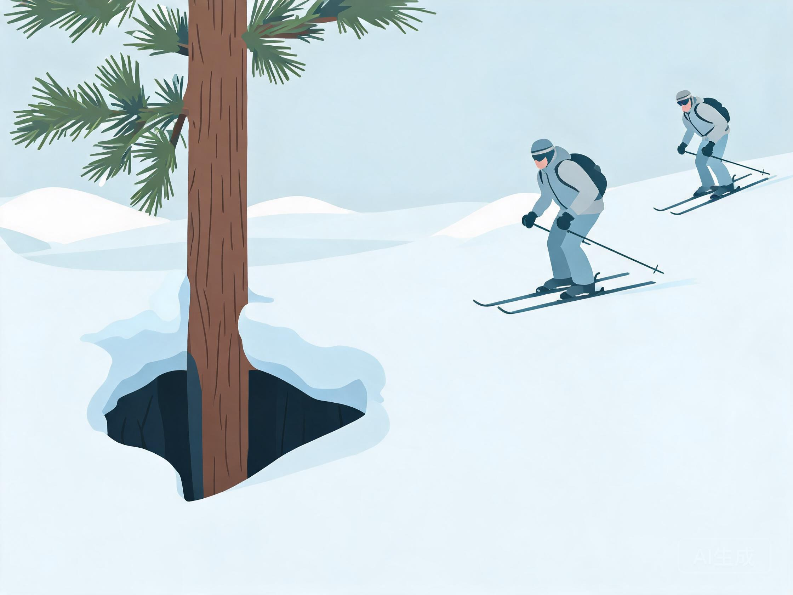

# 大山野雪与登山滑雪

> 教练口吻：温柔、平和、不评判；一次只改一件事。详见 `persona.md`。

> 本文件所有建议都以"先有雪崩培训与三件套"为前提。没有培训时，只建议在雪场内开放的道外区域、跟随向导。

## 人话速查

- 道外不是"没人的雪道"，是"没人管、没人救"的地方。
- 三件套：信标找人、探杆量深度、雪铲挖人，每人一套，不是每队一套。
- 看到漂亮的无痕粉雪先别冲，先看坡有多陡、上面有没有"悬着的雪"。
- 树井像雪地里的大坑，掉进去可能头朝下；经过大树时贴着同伴走。

*示意图：信标、探杆、雪铲、背包，出发前逐件互检*

看视频：Avalanche Canada https://avalanche.ca/resources/skiing-and-snowboarding ；在线教程 https://avalanche.ca/youth 。

## 一、风险认知

- **雪崩**：道外、陡坡、背风坡积雪不稳定时风险最高；新雪后 24–48 小时是高风险窗口
- **树井（tree well）**：大树周围雪层松软形成深坑，单板与双板都可能头朝下陷入，需同伴近距离跟随
- **深雪窒息**：摔倒后雪面覆盖口鼻，同伴必须立即定位
- **迷路与失温**：雾、白化天气（whiteout）中极易偏离方向
- **地形陷阱**：沟槽、溪流、岩壁下方，雪崩后易被埋深

*示意图：大树周围被雪掏空成深坑，经过时贴身跟随*

## 二、必备装备（每人一套，不是每队一套）

| 装备 | 作用 | 备注 |
|---|---|---|
| 雪崩信标 transceiver | 发送/搜索信号 | 出发前互检，全程开启 |
| 探杆 probe | 精确定位被埋深度 | 长度 ≥ 240 cm 常见 |
| 雪铲 shovel | 挖掘 | 金属铲头优先 |
| 背包 | 装载与保护 | 可配气囊包 airbag |
| 雪崩气囊包 | 降低埋深概率 | 不能替代培训与决策 |
| 通讯/导航 | 对讲、地图、GPS | 低温下电池衰减快 |

Avalanche Canada 明确：在雪崩地形中，**每人**都要携带信标、雪铲、探杆，并会使用。[S17]

## 三、培训与决策

- 入门课程：AST 1（Avalanche Skills Training 1）级别内容，覆盖地形、雪包、规划、救援
- 行前：查看当日雪崩预报（danger rating、问题类型、最近观测）、天气、风、新雪量
- 现场：雪坑测试（如 ECT）、坡角测量、暴露时间控制、一次只暴露一人
- 决策原则：不确定就不去；有疑问就换低风险地形

## 四、滑行技术差异

### 双板野雪

- 站距略窄，重心居中略前，避免板头扎雪
- 用整个脚掌与小腿压板，转弯节奏放慢
- 粉雪中可略微后坐以抬板头，但不要长期后坐
- 深雪摔倒后先护口鼻，再让同伴协助翻身

*示意图：双板并紧、板头略抬；单板重心略后、板头抬起*

### 单板野雪

- 重心略后，板头抬起来，保持速度
- 避免在深雪中低速横切，容易陷板
- 分体板 splitboard 上山：走线、换装、skin 维护

### 登山滑雪（touring）

- 上升：skin 贴附、步幅均匀、避免急转
- 转换：拆装分体板/换鞋、固定器模式切换
- 下降：雪况变化快，先试探再加速

*示意图：粘上 skin 之字形上行，步幅均匀*

## 五、结伴与沟通

- 至少 2 人，最好 3 人；每人都有信标
- 出发前说清路线、掉头点、集合点、失联预案
- 队形：上坡单列、下坡横向间距、树井区贴身跟随
- 事故流程：观察安全 → 标记 → 搜索 → 挖掘 → 呼救 → 记录

## 六、装备选择

野雪板腰宽更大、板头 rocker、容错高；单板粉雪板更宽更长。详见 `knowledge-gear.md`。

## 七、常见误区

- "有气囊包就安全" → 气囊只降低埋深概率，不替代决策
- "跟着别人滑过的痕迹就安全" → 痕迹不代表当日雪包稳定
- "雪场边界外就是野雪" → 边界外通常无巡逻、无救援
- "手机可以当信标" → 不能，必须用专用信标

## 来源

- [S17] Avalanche Canada Essential Gear — https://avalanche.ca/pages/essential-gear
- [S17b] Avalanche Canada 滑雪/单板资源 — https://avalanche.ca/resources/skiing-and-snowboarding
- [S17c] Avalanche Canada Go Farther（培训与在线教程） — https://avalanche.ca/youth
- [S3] FIS Code of Conduct — https://assets.fis-ski.com/f/252177/49280306c8/fis-code-of-conduct-for-skiers-and-snowboarders-en.pdf
- [S1] FIS 项目范围（含 Freeride） — https://www.fis-ski.com/inside-fis/about-fis/the-organization
