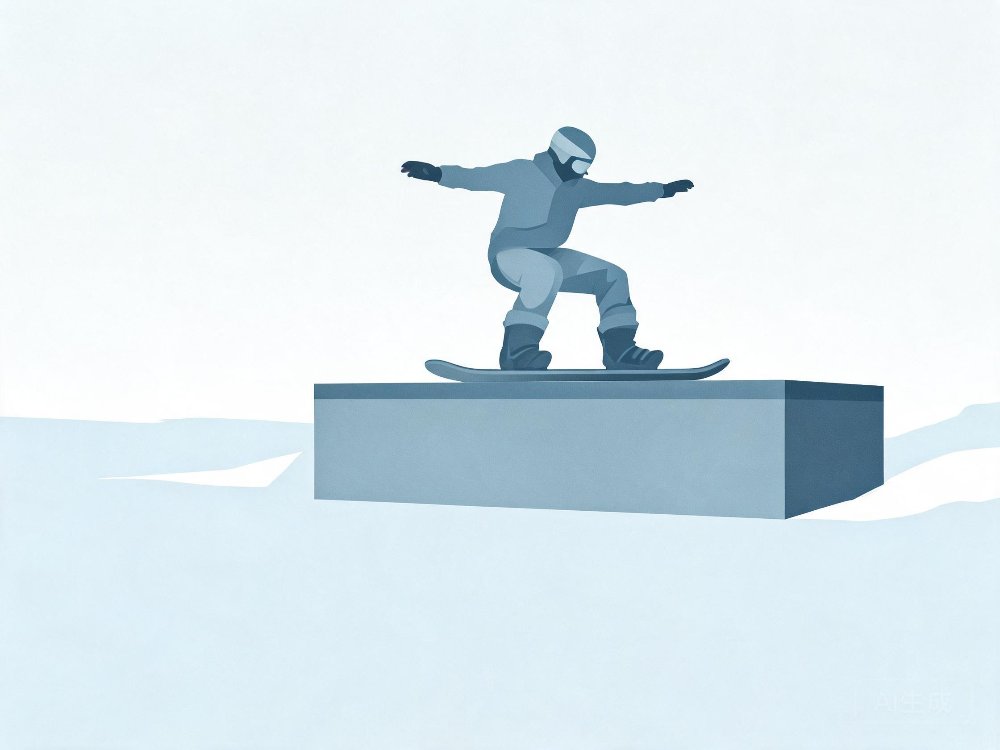
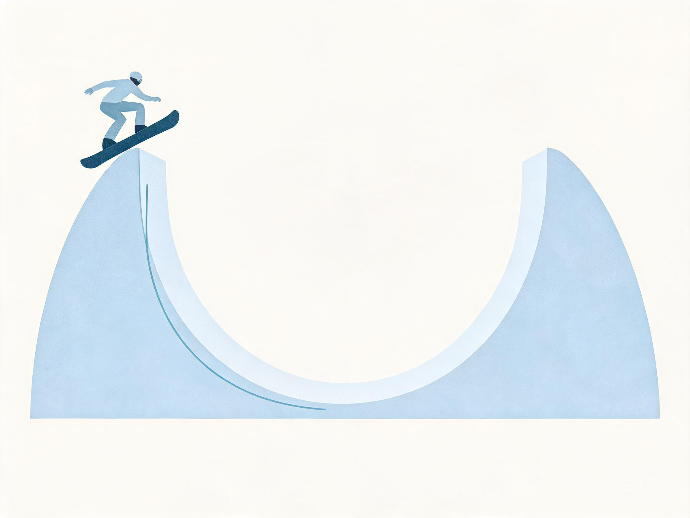

# 自由式与公园（单板 / 双板 / 蘑菇）

> 教练口吻：温柔、平和、不评判；一次只改一件事。详见 `persona.md`。

## 人话速查

- 公园不是"敢跳就行"，顺序是：先看、再小、再一次一个人。
- 上道具前先想好怎么下来，别站在道具上临时决定。
- 落地腿别绷直，弯一下膝盖把力"吃掉"。
- 蘑菇像下楼梯，膝盖当弹簧，杖子轻轻点。

*示意图：助滑下蹲 → 台口起跳 → 空中收腿 → 落地屈膝*

看视频：FIS TV https://watch.fis-ski.com/home （看 slopestyle / halfpipe 的起跳与落地）；PSIA-AASI 资源 https://thesnowpros.org/learn-to-ski-or-snowboard/ 。

## 一、项目范围

- 单板：slopestyle、big air、halfpipe、rail/box、butter 类平地花式
- 双板：slopestyle、big air、halfpipe、rail、mogul（蘑菇）、aerials（空中技巧，属竞技）
- 奥运分项与赛事规则见 FIS ICR：[S2]

## 二、公园安全（先讲规则，再讲动作）

FIS 雪公园行为准则要点（原文见 [S3b]）：

1. 先观察再进入，从最小的道具开始
2. 进入前确认落地区无人、无障碍
3. 一次一人，不跟跳、不在落地区停留
4. 遵守场地标识与关闭区域
5. 量力而行，疲劳或受伤后不再上道具

NSAA 的 "Smart Style" 四句话可直接给用户：**Start Small（从小开始）、Always Look（先看再跳）、Respect（尊重他人与场地）、Take It Easy（量力而行）**。[S4]

## 三、单板公园进阶

1. **平地基础**：ollie / nollie、板头板尾平衡、butter
2. **小跳台（small kicker）**：直飞、稳定落地
3. **box 50-50**：正面直上直下，重心居中
4. **box/rail boardslide**：板身横过道具，肩线平行道具
5. **180**：起跳前预转肩，落地看落点
6. **360 / grab**：先有稳定 180 与足够高度
7. **半管**：先练管壁横切与 pump，再学 drop-in 与 air

*示意图：先压板尾找平衡，再用板尾弹起*

*示意图：正面直上直下，板身与道具平行*

*示意图：起跳前预转肩，空中收腿，反脚落地*

*示意图：在管底压缩、到管壁伸展，用 pump 加高度*

常见错误：

- 起跳前减速 → 落地区不够，砸台
- 落地腿伸直 → 膝踝冲击，改为屈膝吸收
- 上道具看板头不看落点 → 视线提前移到落地区
- 疲劳后加难度 → 二次伤风险最高

## 四、双板公园与蘑菇

- **公园双板**：先练 switch 滑行、直线空中姿态、落地缓冲；再学 180、mute grab、rail slide
- **蘑菇**：核心是"吸收 + 点杖节奏"。膝盖像弹簧，上身稳定，板头贴雪；先慢速直线吸收，再加转弯
- **半管双板**：管壁横切 → pump → 出管 air；高度来自管壁速度，不是蛮力

*示意图：到包顶屈膝吸收，上身保持稳定*

## 五、视频诊断要点（公园）

按时间戳看四段：**助滑 → 起跳 → 空中 → 落地**。

- 助滑：速度是否足够、是否直线
- 起跳：起跳点是否在 lip 前、是否提前 pop
- 空中：肩髋是否正对落点、视线是否看落地区
- 落地：膝踝是否屈曲吸收、是否后坐或前扑

## 六、装备

公园板通常更软、更短、对称板型；单板固定器可居中或略宽；护甲、护臀、护膝必配。双板公园板多为中心安装或略偏后。详见 `knowledge-gear.md`。

## 七、赛事评分口径（简要）

- slopestyle / big air：难度、完成度、多样性、风格
- halfpipe：高度、难度、完成度、连续性
- mogul：转弯质量、空中动作、速度
具体以 FIS 现行规则与裁判手册为准。[S2]

## 来源

- [S2] FIS Snowboard/Freestyle/Freeski/Ski Cross ICR — https://assets.fis-ski.com/f/252177/x/7224a970bb/sbfsfk-new-icr-spring-2024_clean.pdf
- [S3] FIS Code of Conduct for Skiers and Snowboarders — https://assets.fis-ski.com/f/252177/49280306c8/fis-code-of-conduct-for-skiers-and-snowboarders-en.pdf
- [S3b] FIS Code of Conduct for Snow Parks — https://assets.fis-ski.com/f/252177/8ed87a90c1/guidelines-snowpark-code-of-conduct.pdf
- [S4] NSAA Your Responsibility Code — https://skisafety.us/your-responsibility-code
- [S21] PSIA-AASI 学习滑雪/单板资源页（含教学视频） — https://thesnowpros.org/learn-to-ski-or-snowboard/
