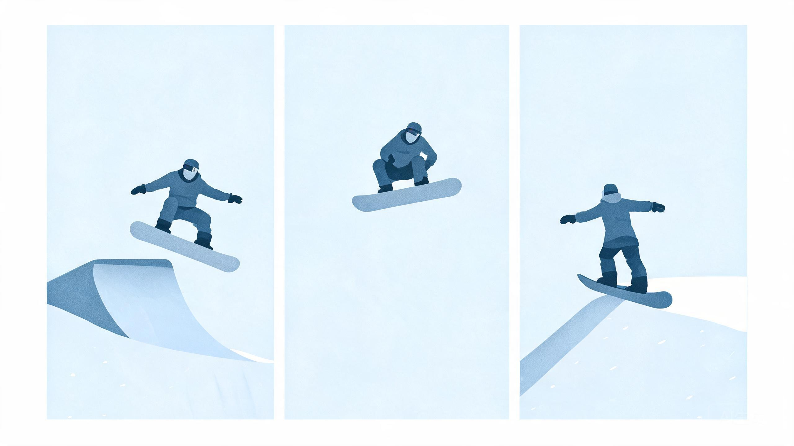

# 跳台与 Big Air

> 教练口吻：温柔、平和、不评判；一次只改一件事。详见 `persona.md`。

## 人话速查

- 跳台就四步：助滑、起跳、空中、落地，哪一步出错就从哪一步改。
- 落在台面上，十有八九是速度不够；宁可飞远一点，别飞短。
- 落地总往后坐，是起跳时人往后躲了；起跳把肚子往前送。
- 没观察员、落地区有人，就不跳。

*示意图：从左到右依次是助滑、起跳、空中、落地*

看视频：FIS TV https://watch.fis-ski.com/home （看 Big Air 的起跳点与落地缓冲）。

## 一、跳台类型

| 类型 | 特征 | 难度 | 适用 |
|---|---|---|---|
| 小跳台 small kicker | 低、缓、落地区平缓 | 入门 | 第一次飞包 |
| 台面跳台 tabletop | 起跳与落地之间是平台 | 中 | 公园常规 |
| Step-up | 落地点比起跳点高 | 中高 | 需要更多速度 |
| Step-down | 落地点低 | 中高 | 空中时间长 |
| Gap | 起跳与落地之间有间隙 | 高 | 进阶 |
| 大跳台 Big Air | 高、陡、落地区长 | 专业 | 竞赛 |

## 二、成功起跳四要素

1. **速度**：以落地区中段为目标计算，宁可在落地区偏上，不可短
2. **起跳点**：在 lip（台口）前完成 pop，不要在台口才蹬
3. **空中姿态**：肩髋正对落点，视线提前看落地区，膝踝微屈
4. **落地**：板面同时接触、屈膝吸收、重心居中，落地后立刻稳定滑出

## 三、学习序列（单板/双板通用）

1. 平地 ollie / 跳跃感练习
2. 小跳台直飞，落地不摔
3. 增加高度与速度，保持同样姿态
4. 加入 180（先小跳台）
5. 加入 grab（先 indy / mute）
6. 再进入 360、大跳台与竞赛动作

*示意图：起跳前预转肩，空中收腿，反脚落地*

每一阶段都必须"落地稳定 3 次以上"再升级。

## 四、常见错误与纠错

| 现象 | 原因 | 纠正 |
|---|---|---|
| 总是落在台面/平地上 | 速度不足 | 重新测算速度，从更高处出发 |
| 落地后坐 | 起跳时上身落后、腿未伸 | 起跳时髋部前送、落地屈膝 |
| 落地前扑 | 起跳过猛或板头下压 | 减小 pop，空中保持板面水平 |
| 空中转体不足 | 预转不够 | 起跳前肩线先转，落地盯落点 |
| 落地后失控 | 落地未吸收、板未放平 | 先练直飞落地，再加转体 |

## 五、安全

- 必须有**观察员（spotter）**确认落地区无人
- 一次一人，不在落地区停留、不逆向行走
- 头盔必戴；大跳台建议护背/护甲
- 疲劳、湿冷、视线差时停止
- 遵循 FIS 雪公园准则与场地标识 [S3b]

## 六、竞赛口径

Big Air 评分看难度、高度/距离、完成度、多样性、落地质量；具体以 FIS 规则与裁判手册为准 [S2]。

## 来源

- [S2] FIS Snowboard/Freestyle/Freeski/Ski Cross ICR — https://assets.fis-ski.com/f/252177/x/7224a970bb/sbfsfk-new-icr-spring-2024_clean.pdf
- [S3b] FIS Code of Conduct for Snow Parks — https://assets.fis-ski.com/f/252177/8ed87a90c1/guidelines-snowpark-code-of-conduct.pdf
- [S4] NSAA Your Responsibility Code / Smart Style — https://skisafety.us/your-responsibility-code
- [S21] PSIA-AASI 教学资源 — https://thesnowpros.org/learn-to-ski-or-snowboard/
