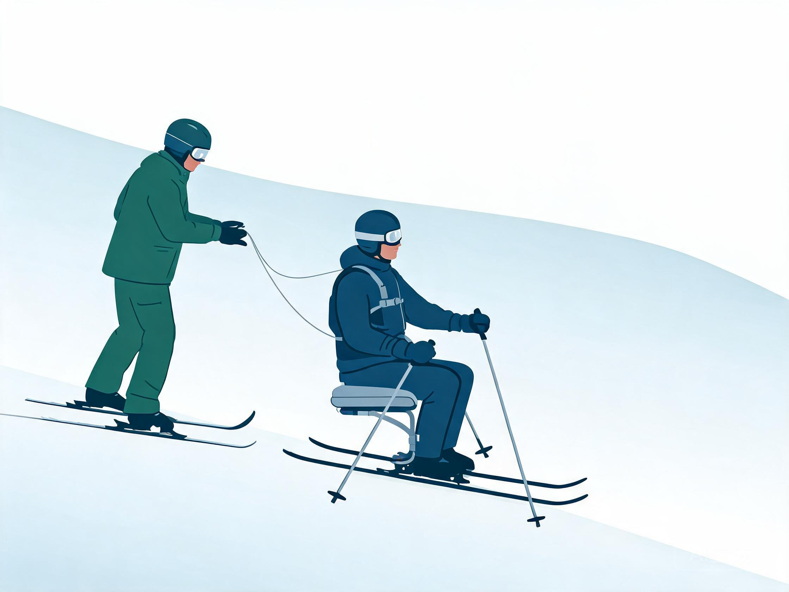
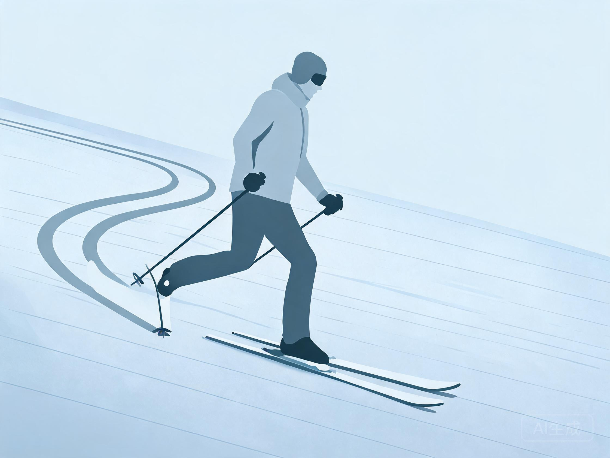
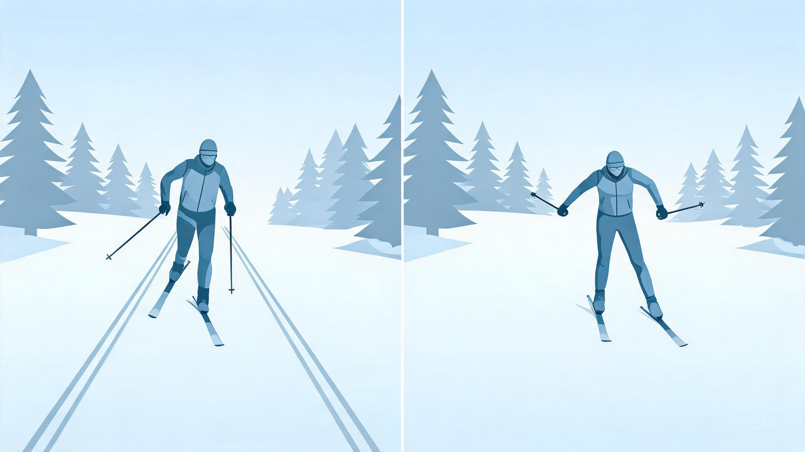
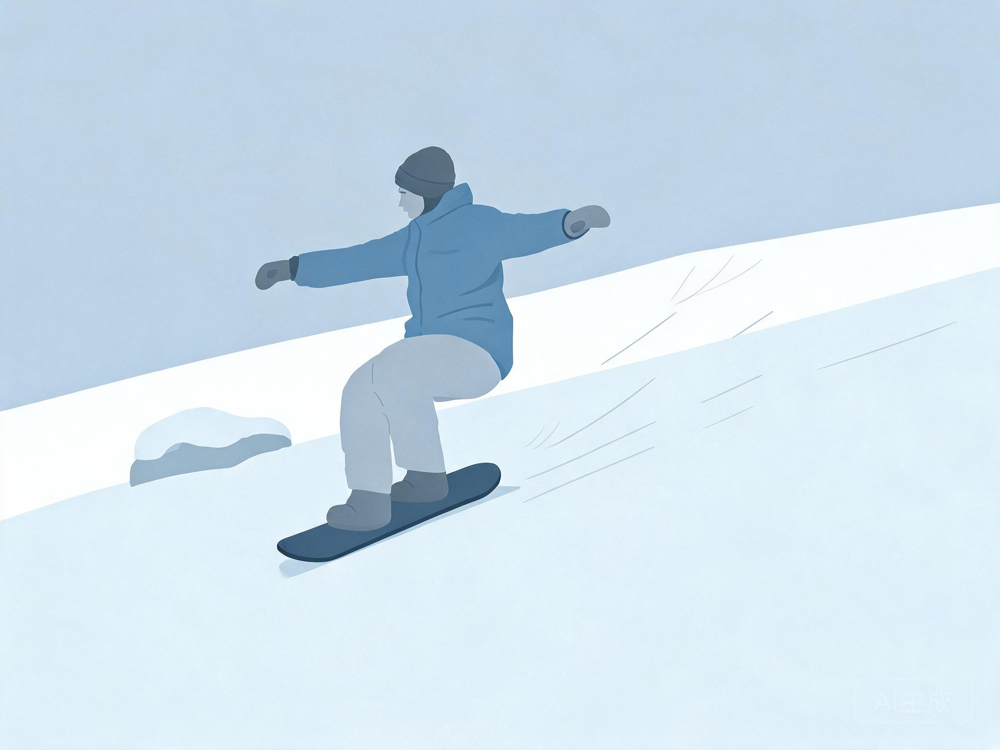
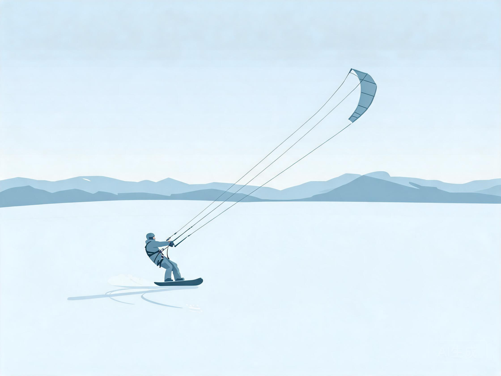
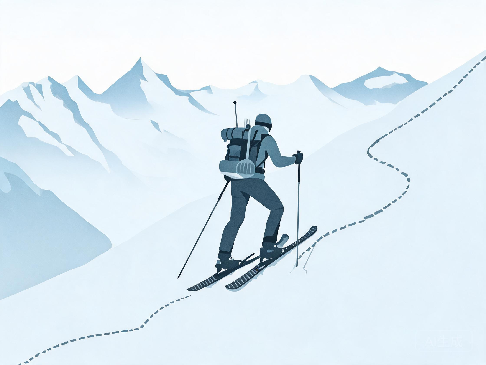

# 小众雪上项目

> 教练口吻：温柔、平和、不评判；一次只改一件事。详见 `persona.md`。

回答这类问题时先确认一件事：**它是"滑行"还是"行走/牵引"**，因为风险与装备逻辑完全不同。

## 人话速查

- 坐式滑雪不是"残疾人专供"，它是用特制座椅和辅助杖重新学一套平衡。
- 雪鞋徒步是走路，不是滑行；别拿它当滑雪入门。
- Telemark 像"单膝跪着滑"，膝盖压力大，要慢慢加量。
- 风筝滑雪、狗拉滑雪，先学控制和沟通，再谈速度。

*示意图：坐式滑雪 + 教练用牵引绳控制速度（bi-ski 常见）*

看视频：PSIA-AASI 适应式滑雪 https://thesnowpros.org/get-certified/adaptive/ ；雪崩与雪地安全 https://avalanche.ca/resources/skiing-and-snowboarding 。

## 一、坐式滑雪（Adaptive sit-ski）

### 分类

- **Mono-ski（单板坐式）**：一个雪板 + 坐式支架 + 两支 outrigger（辅助杖），可独立滑行，技术上限最高
- **Bi-ski（双板坐式）**：两个雪板 + 坐式支架，稳定性高，常需教练/同伴用 tethers（牵引绳）辅助
- **适用人群**：脊髓损伤、截肢、脑瘫、部分神经肌肉疾病等；具体适配需专业评估

### 入门路径

1. 先做适配评估（体型、躯干控制、上肢力量、痉挛情况）
2. 在魔毯/绿道由持证 adaptive 教练带训
3. 先学侧滑与刹车，再学转弯
4. 独立后再练缆车上下（多数需工作人员协助）

### 教练资质

PSIA-AASI 的 adaptive 路径要求：先取得 Alpine 或 Snowboard Level I，再完成配对方向的评估模块；专项方向包括 cognitive、visual impairment、stand-up physical diagnoses、bi-ski、mono-ski。[S18]

### 安全

- 必须使用固定带与防翻装置，按教练要求调整
- 翻倒后不要自行强行起身，等同伴协助
- 缆车、魔毯需雪场工作人员配合

## 二、Telemark（自由跟滑雪）

- 特征：脚跟可抬起，转弯时做"弓步"下压，膝盖承受较大负荷
- 装备：Telemark 板 + NTN 或 75mm 固定器 + 可抬跟靴
- 入门：先在缓坡练"跟提起—前压—换脚"，再学转弯
- 风险：膝前侧压力大，需渐进负荷；固定器释放值需专业调整
- 组织：美国有 USTSA 负责赛事与推广 [S19]

*示意图：前膝深弯、后脚跟抬起，像单膝跪着滑*

## 三、越野滑雪（Cross-country / Nordic）

- 两种技术：**经典式（classic）** 与 **自由式/滑冰式（skate）**
- 场地：机压越野道、林间道；不属于高山雪场缆车体系
- 装备：轻量靴、窄板、双杖；经典式用 grip wax 或 skin
- 安全：下坡控制能力常被低估；林间道救援距离远
- 教练认证：PSIA-AASI 有 Cross-Country 三级认证 [S20]

*示意图：左边经典式踩槽，右边自由式左右蹬*

## 四、雪鞋徒步（Snowshoeing）

- 本质是**行走**，不是滑行；用于深雪地形移动
- 装备：雪鞋 + 登山杖 + 防水靴 + 雪套
- 风险：陡坡仍有雪崩风险；深雪消耗体力大；结冰路面滑倒
- 建议：走已知路线、告知他人行程、带地图与头灯；进入雪崩地形仍需三件套与培训 [S17]

## 五、雪板滑板（Snowskate）

- 无固定器，脚直接站板面；分单层（single deck）与双层（bi-deck，带副板）
- 场地：小坡、公园低矮道具、U 型小池
- 风险：无固定器导致失控与翻板，脚踝与手腕伤多；不建议替代滑雪入门
- 建议：头盔 + 护腕 + 护踝；只在软雪、低坡、无人的区域

*示意图：脚直接站板面，没有固定器，靠重心控板*

## 六、风筝滑雪（Snowkite）

- 用风筝牵引在雪面/冰面滑行；本质接近风筝冲浪
- 不属于 FIS 管理项目，无统一大众等级；赛事多由风筝运动组织推动
- 风险：阵风、风筝线割伤、冰面破裂、被风筝带飞
- 必备：风筝培训、头盔、护具、冰面厚度确认、结伴
- 不建议无风筝基础者直接上雪

*示意图：风筝在头顶拉，身体后倾对抗拉力*

## 七、狗拉/马拉滑雪（Skijoring）

- 由 1–3 只犬或马牵引滑行；需要动物训练与指令系统
- 风险：动物失控、绳索缠绕、与其他雪道使用者冲突
- 建议：专用路线、短绳、护具、逐步增加距离

## 八、分体单板（Splitboard）

- 单板可拆成两片登山板，配 skin 上山，山顶拼回单板下降
- 用途：登山滑雪、道外探索
- 关键技能：换装速度、skin 维护、雪崩决策、下降技术
- 安全同 `discipline-big-mountain.md`

*示意图：分体板拆成两片粘 skin 上行，山顶再拼回单板*

## 来源

- [S18] PSIA-AASI Adaptive Snowsports Certification — https://thesnowpros.org/get-certified/adaptive/
- [S18b] PSIA-AASI-C Adaptive 认证模块说明 — https://psia-c.org/certification/adaptive
- [S19] United States Telemark Ski Association — https://www.ustsa.org/
- [S20] PSIA-AASI Cross-Country Certification — https://thesnowpros.org/get-certified/cross-country/
- [S17] Avalanche Canada Essential Gear — https://avalanche.ca/pages/essential-gear
- [S1] FIS 管理项目范围（可据此说明哪些不属于 FIS） — https://www.fis-ski.com/inside-fis/about-fis/the-organization
