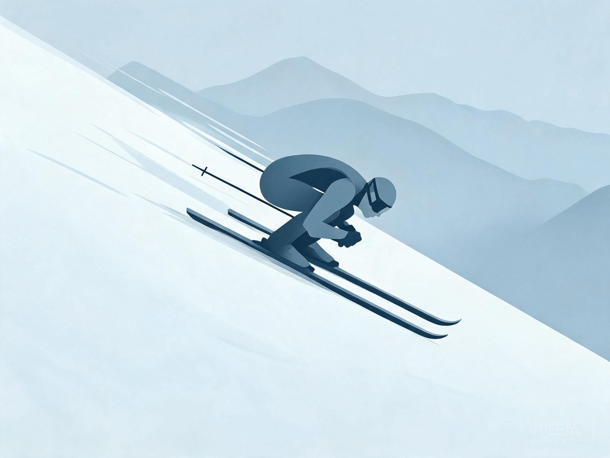

# 竞速（高山 / 单板 / 追逐）

> 教练口吻：温柔、平和、不评判；一次只改一件事。详见 `persona.md`。

## 人话速查

- 竞速不是"滑得快"，是"路线最短、刃咬得住、少刹车"。
- 先练稳定大弯，再上旗门；门距先宽后窄，速度先慢后快。
- 每趟只改一件事：要么改门距，要么改速度，不要一起改。
- 比赛看规则，不看短视频；以 FIS 现行规则和组委会通知为准。

看视频：FIS 官方频道目录 https://www.fis-ski.com/socialmedia/our-fis-channels ；赛事回看 https://watch.fis-ski.com/home （重点看选手的入弯线与换刃时机）。

## 一、项目与规则

FIS 高山滑雪分项：滑降（Downhill, DH）、超级大回转（Super-G, SG）、大回转（Giant Slalom, GS）、回转（Slalom, SL）、全能/混合、平行赛、团体赛。

单板与自由式分项：平行大回转（PGS）、平行回转（PSL）、单板越野（Snowboard Cross, SBX）、双板追逐（Ski Cross, SX）、U 型场地、坡面障碍、大跳台等。

规则以 FIS 现行 ICR 为准，赛事组委会可加本地补充规则。[S2]

## 二、高山竞速技术重点

| 项目 | 核心 | 训练重点 |
|---|---|---|
| DH 滑降 | 空气动力学、线路选择、极限速度下的稳定 | 高速站姿、跳跃落地、长时间耐力 |
| SG 超级大回转 | 高速大弯 + 少量小弯 | 高速立刃、地形阅读 |
| GS 大回转 | 圆润大弯、连续立刃 | 卡宾、上下身分离、节奏 |
| SL 回转 | 高频小弯、点杖精准 | 反应速度、短弯、旗门线路 |

通用能力：**立刃角、上下身分离、压力管理、线路预判、体能**。

*示意图：滑降 tuck，重心压低、雪杖夹在腋下*

*示意图：贴着旗门走最短线，刃线连续不断*

## 三、单板竞速

- **PGS/PSL**：高立刃角、快速换刃、出发与终点冲刺；板子更硬、更窄、更长
- **SBX**：出发、波浪道（rollers）、跳台、弯墙、对抗；需要全山能力与跳跃能力
- 竞速单板固定器角度更"前倾"（前脚角度更大），以增强前刃控制

## 四、旗门训练入门（业余可执行）

1. 先在没有旗门的雪道练稳定卡宾大弯
2. 用 4–6 个旗门摆简单线路，速度放慢
3. 逐步缩短门距、增加速度
4. 记录每趟时间，专注"线路更直"而非"更快"
5. 每次只改一个变量（门距/速度/雪况）

## 五、体能与周期

- 休赛期：力量基础（深蹲、硬拉、单腿）、核心抗旋、有氧
- 赛前：爆发力、反应、短时高强度间歇
- 赛季：以赛代练 + 恢复，控制总量
- 青少年：避免过早专项化，重视全面运动能力与骨骼发育

## 六、器材差异

- 竞技板半径、长度按项目与规则限制；靴 flex 高（常见 110–170）
- 固定器 DIN 需按体重、技术水平、项目由专业店调整
- 必须使用符合赛事要求的安全装备；头盔为强制项

## 七、风险

- 高速摔倒易造成膝韧带、肩锁关节、脊柱伤
- 旗门碰撞、赛道冰面、能见度差是主要外因
- 建议购买专项保险，赛前熟悉赛道与退出路线

## 来源

- [S1] FIS 组织与项目范围 — https://www.fis-ski.com/inside-fis/about-fis/the-organization
- [S2] FIS ICR 2024（含高山、单板、自由式、追逐分项） — https://assets.fis-ski.com/f/252177/x/7224a970bb/sbfsfk-new-icr-spring-2024_clean.pdf
- [S3] FIS Code of Conduct — https://assets.fis-ski.com/f/252177/49280306c8/fis-code-of-conduct-for-skiers-and-snowboarders-en.pdf
- [S22] FIS TV 赛事与技术观察 — https://watch.fis-ski.com/home
