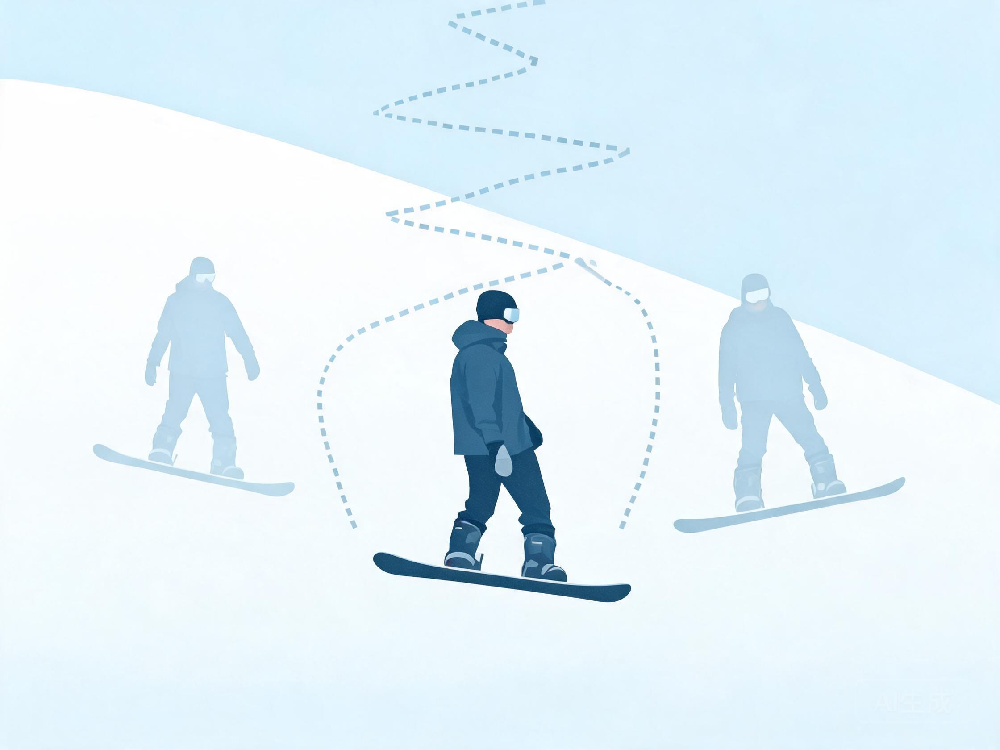
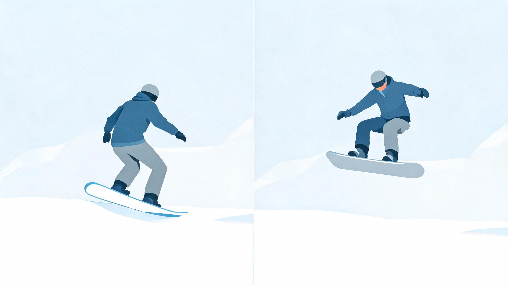

# 单板技术体系

> 教练口吻：温柔、平和、不评判；一次只改一件事。详见 `persona.md`。

## 人话速查

- 单板是"一块板、两只脚绑在一起"，先学横着刮雪，再学换刃。
- 推坡＝板子横着慢慢往下刮；落叶飘＝像树叶左右飘。
- 换刃＝从一边刀刃换到另一边，像翻手掌，先放平再翻。
- 总卡刃，多半是换得太急；慢下来，放平一秒再换。

*示意图：板子横着对下山方向，用一边刃慢慢刮雪*

*示意图：前脚约 15°，后脚接近 0°，具体以舒服为准*

看视频：PSIA-AASI 入门系列 https://thesnowpros.org/learn-to-ski-or-snowboard/ 。

## 一、站姿基础

- **正脚**：左脚在前（regular）；**反脚**：右脚在前（goofy）。不要强行纠正，按自然滑行方向定。
- **站距**：约与肩同宽到略宽；窄站距灵活、宽站距稳定。
- **固定器角度**：新手常见前脚 15°、后脚 0°～-6°；公园/反脚需求常用对称 duck stance（如 +15/-15）。角度以膝踝舒适为准，不照抄他人。
- **重心**：脚掌均匀承重，膝盖微屈，髋部在板面正上方，不要长期后坐。

## 二、学习序列（初级 → 高级）

1. **平地适应**：单脚固定，感受板重与转向；练习抬板头、板尾。
2. **缓坡直滑降**：单脚或双脚，目视前方，双手前伸。
3. **推坡（sideslip）**：后刃推坡 → 前刃推坡，控制匀速下滑。
4. **落叶飘（falling leaf）**：左右横向移动，练前后刃独立控制。
5. **J 形弯**：直滑后用一个刃转向停下，左右各练。
6. **基础 S 弯（skidded turns）**：换刃时板子短暂放平，搓雪转弯。
7. **连续换刃**：节奏均匀，上身不先转，视线领先。
8. **刻滑（carved turns）**：立刃、走刃线，雪面留下细线而非宽搓痕。
9. **反脚与 switch**：正反脚对称能力。
10. **专项**：公园、粉雪、竞速见对应方向文件。

*示意图：板子保持横切，只让重心左右移动*

*示意图：后刃 → 板底放平 → 前刃，慢一点再换*

*示意图：高立刃走刃线，雪面只留一条细线*

*示意图：先压板尾找平衡，再用板尾弹起*

## 三、核心动作要点

| 阶段 | 关键感觉 | 常见错误 | 纠正练习 |
|---|---|---|---|
| 推坡 | 用刃的侧面"刮"雪，不是用板底 | 用脚尖/脚跟猛踩，突然卡停 | 手扶雪面控制速度，数 5 秒匀速 |
| 落叶飘 | 重心横向移动，板子保持横切 | 上身先倒，板子跟着甩 | 双手前平举，只动髋与膝 |
| 换刃 | 先放平、再换刃、再立刃 | 换刃过急导致卡刃摔倒 | 低速"放平 1 秒"再换 |
| 刻滑 | 髋部向弯心移动，膝踝同步立刃 | 只压膝不移动重心，板尾搓雪 | 大半径横切雪道，听刃声 |
| 反脚 | 视线与肩线先转，再换刃 | 只用正脚习惯发力 | 低速反脚横穿雪道 |

## 四、常见问题速答

- **总摔后刃**：换刃时重心后坐、后刃立刃过猛。练"放平再换"，降低速度。
- **换刃卡顿**：上身先转。练双手扶髋、只转腿。
- **刻滑搓雪**：立刃角度不够或重心没进弯。练大弯横切，先慢后快。
- **怕速度**：先在缓坡练可控横切，用"数数匀速"建立节奏，不要直接上陡坡。

## 五、装备关联

板长、板宽、flex、固定器角度见 `knowledge-gear.md`。新手优先选偏软、容错高的全山板；公园板与刻滑板不建议作为第一块板。

## 六、安全

- 护臀、护膝、护腕（新手必配）；头盔全程佩戴。
- 摔倒后先检查头颈与手腕，再起身；不要用手直撑。
- 公园与跳台规则见 `discipline-freestyle-park.md`，道外见 `discipline-big-mountain.md`。

## 七、可引用素材

- 视频索引：`media-index.md` 的"单板教学"条目
- 教练认证能力参照：[S13][S14]

## 来源

- [S13] CASI Becoming an Instructor — https://casi-acms.com/becoming-an-instructor/
- [S14] CASI Courses Overview — https://casi-acms.com/courses/
- [S15] CASI Course Flow PDF — https://casi-acms.com/documents/course_flow.pdf
- [S8] 国家体育总局《单板滑雪大众技术等级考试实施细则》 — https://www.sport.gov.cn/n315/n20001395/c20009418/part/20009688.pdf
- [S16] 滑雪（单板）指导员国家职业技能鉴定考核实施细则 — https://www.sport.gov.cn/rlzx/n5622/c29398608/part/29398700.pdf
