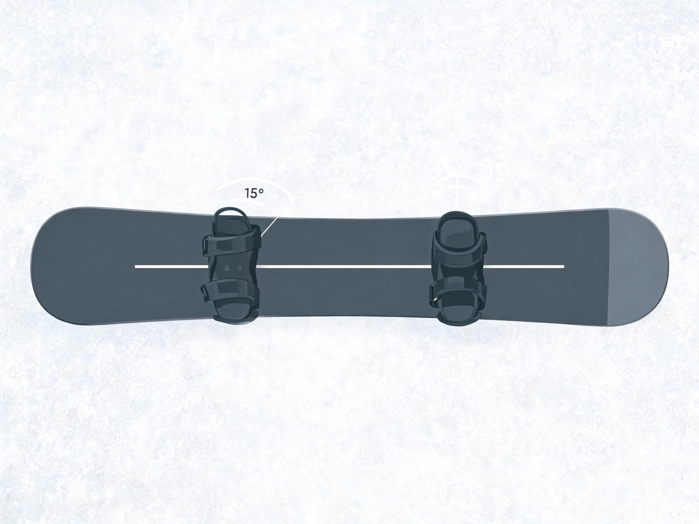
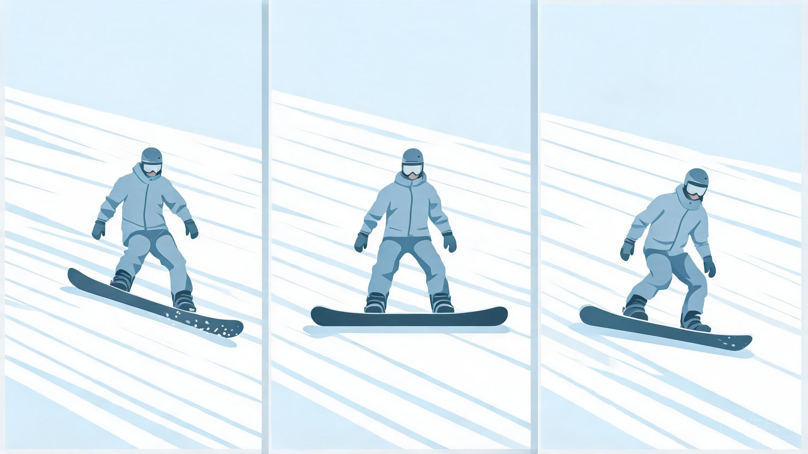
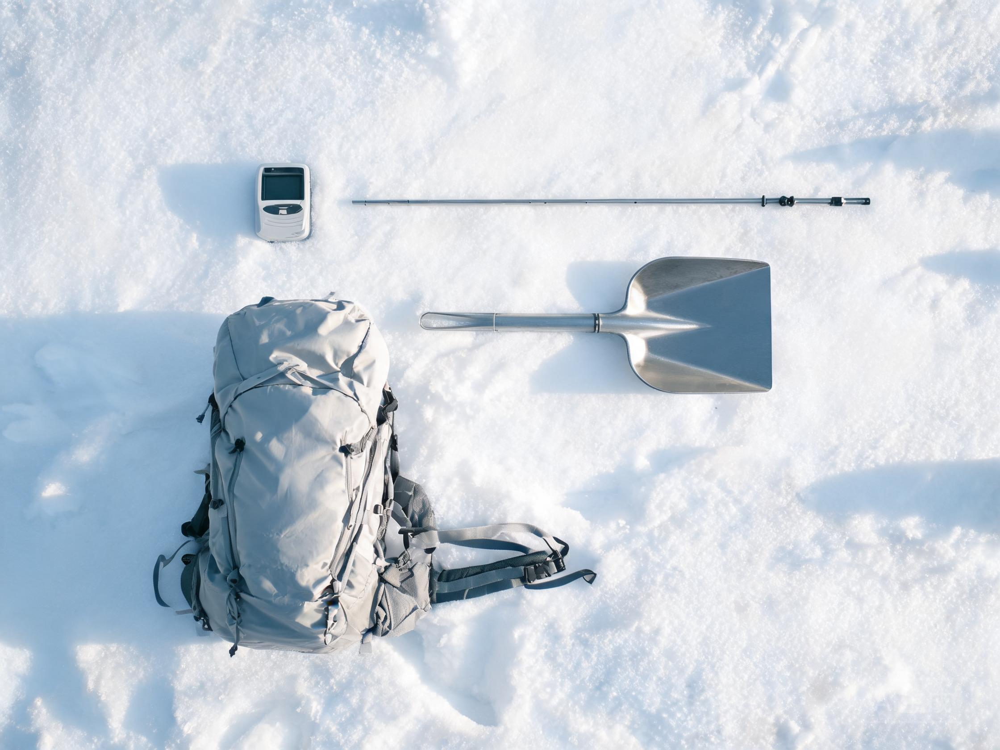

# 新手常见问题速答

> 教练口吻：温柔、平和、不评判；一次只改一件事。详见 `persona.md`。

用途：用户一次抛出大量问题时，先在这里按编号速答，再对关心的条目展开。
回答仍遵守 `plain-language.md`：先结论、再打比方、术语加括号。

专项速查：单板见 `faq-snowboard.md`，双板见 `faq-alpine.md`，装备见 `faq-gear.md`。

## 三条总原则

1. 第一次去：**租装备、请教练、只待绿道**。
2. 单板还是双板：**怕摔选双板，想帅选单板**。
3. 装备：**贴身买，大件租**。

## 一、入门与选择

| # | 问题 | 速答 |
|---|---|---|
| 1 | 第一次先准备什么 | 先订雪票和教练，再备三层衣、手套、雪镜、防晒；出发前查天气和开放雪道 |
| 2 | 滑雪难学吗 | 双板 1 天能站能停，约 3 天下绿道；单板一般多摔 1–2 天，因人而异 |
| 3 | 单板和双板怎么选 | 怕摔、想快下绿道选双板；喜欢公园、风格、不怕前期摔选单板 |
| 4 | 第一次要请教练吗 | 要。2 小时足够学穿脱、站姿、刹车、上下缆车，比自学省一天 |
| 5 | 从哪条雪道开始 | 绿圈和魔毯区，坡度缓、人流慢；别上蓝道 |
| 6 | 装备租还是买 | 板、鞋、杖、头盔租；速干衣、滑雪袜、手套、护脸买 |
| 7 | 必须戴头盔吗 | 必须。头盔是底线，戴了也要控速；撞过的头盔要换 [S6] |
| 8 | 护腕、护膝、护臀哪个重要 | 单板：护腕 > 护臀 > 护膝；双板：护膝 > 护臀。头盔都戴 |
| 9 | 滑雪服里面怎么穿 | 三层：排汗层 + 保暖层 + 防水外层；别穿纯棉内衣 |
| 10 | 滑雪袜和普通袜子区别 | 滑雪袜长到膝下、薄、无褶皱、排汗；棉袜会磨脚、湿冷 |
| 11 | 雪镜为什么起雾 | 镜内暖湿、镜外冷，水汽凝在镜片；别用手擦内侧，开通风口 |
| 12 | 雪镜和墨镜能互换吗 | 不能。雪镜防冲击、防侧光、防紫外线；墨镜摔了会碎 |
| 13 | 手套分指还是连指 | 分指灵活，方便调扣、拍照；连指更暖。新手选防水分指或三指 |
| 14 | 雪鞋穿多紧合适 | 脚趾轻碰鞋头、脚跟不抬、扣紧但不麻；太松控不住板 |
| 15 | 雪板长度怎么选 | 双板常见“身高减 10–15 cm”，新手偏短；单板常见到下巴，体重大加长 |
| 16 | 固定器角度怎么定 | 新手前脚约 15°、后脚 0°～-6°；公园常用 ±15°；以膝踝舒服为准 |
| 17 | 滑雪前怎么热身 | 5–10 分钟动态热身：开合跳、髋绕环、高抬腿、侧弓步、踝泵 |
| 18 | 摔倒怎么保护自己 | 侧倒、团身、护头，别用手直撑；板子横着对坡 |
| 19 | 摔倒后怎么站起来 | 双板把板横坡、手撑山下侧；单板先坐或跪，板横坡再撑起 |
| 20 | 平地怎么行走转向 | 双板交替推雪、抬板尾转向；单板单脚固定，抬板头转向 |
| 21 | 怎么穿脱雪板 | 双板先踩脚尖再压脚跟，脱时按后跟；单板先穿前脚再穿后脚 |
| 22 | 怎么安全坐缆车 | 等椅停稳再上前，坐满、脚放脚踏、提前抬护栏，到站抬板头 |
| 23 | 下缆车最容易犯什么错 | 提前站起、推挤、不抬板头，摔倒后堵在出口 |

*示意图：新手先学这个"八"字，能停住再上缆车*

*示意图：单板新手前脚约 15°，后脚接近 0°*

## 二、雪场规则与安全

| # | 问题 | 速答 |
|---|---|---|
| 24 | 雪道颜色代表什么 | 绿圈最简单，蓝方较难，黑钻难，双黑极难；以现场雪道图为准 [S5] |
| 25 | 怎么判断雪道适不适合 | 看坡度、雪面、宽度、人流；能随时停住就适合，停不住就是太难 |
| 26 | 安全距离留多少 | 至少 3–5 个弯、约 10–20 米；人多、速度快再拉大 [S4] |
| 27 | 雪场基本礼仪 | 不插队、不占道、摔倒快移边、不闯关闭区、不尾随、不外放音乐 |
| 28 | 撞到人责任怎么分 | 后方和上方让前方；中国按过错责任。交换信息、报雪场、走保险 |
| 29 | 手机和贵重物品怎么放 | 贴身内袋、拉链封好；低温掉电快，别放外袋 |
| 30 | 滑雪保险有必要吗 | 有。选含滑雪和高风险运动的，看清除外条款 |
| 31 | 天气影响有多大 | 很大。大风、白化、雨夹雪让人看不清、雪变黏；低温雪硬，回暖雪软 |
| 32 | 冰面、湿雪、粉雪区别 | 冰面硬滑靠边刃；湿雪重、粘板；粉雪软、要速度和重心 |
| 33 | 雪质不好怎么调动作 | 降速、加大立刃、重心居中、弯形缩短，别硬冲 |
| 34 | 夜滑注意什么 | 灯光有阴影、体感更冷、视野差；用高透光镜片，不单独滑 |
| 35 | 为什么会晒伤 | 雪面反射强，加上海拔高，紫外线翻倍；阴天也要防晒 |
| 36 | 怎么防冻伤和失温 | 分层穿、勤活动、避风、热饮；皮肤发白变硬就是冻伤，别搓 |
| 37 | 怎么补水 | 每 20–30 分钟喝几口温水；冷天不觉渴也会脱水 |
| 38 | 滑完肌肉酸痛怎么恢复 | 拉伸、热水澡、补蛋白、睡够；持续肿胀或剧痛要就医 |

## 三、健康与人群

| # | 问题 | 速答 |
|---|---|---|
| 39 | 膝盖不好还能滑吗 | 先问医生。双板对膝内侧韧带压力大，可戴护膝、选软靴、避开冰面 |
| 40 | 手腕和尾骨怎么防伤 | 单板戴护腕和护臀；摔时别手撑、别直坐，侧倒团身 |
| 41 | 孩子几岁能开始 | 常见 3–4 岁玩雪、4–6 岁正式学；看注意力和体重，不硬推 |
| 42 | 儿童要专门教练吗 | 要。儿童教学法和成人不同，雪场儿童课程更合适 |
| 43 | 老人滑雪注意什么 | 短时、低速、护具齐全；先查心血管和骨密度，别疲劳滑 |
| 44 | 朋友水平差距大怎么一起滑 | 约集合点，高手陪低手一段，其余分开滑；别把新手带上高级道 |
| 45 | 一个人滑雪安全吗 | 雪场内可以，但要告诉人行程；道外绝对不要单独去 |

## 四、双板技术

| # | 问题 | 速答 |
|---|---|---|
| 46 | 犁式刹车怎么练 | 板头靠近、板尾推开成三角，用内刃刮雪；膝微屈、重心在前脚掌 |
| 47 | 怎么从犁式过渡平行 | 先半犁式：转弯时收山上板；再把重心交给山下板，双板同步 |
| 48 | 转弯重心放哪 | 放在山下板（外侧板），肚子朝山下，别坐后跟 |
| 49 | 怎么控制速度 | 靠弯形、立刃和线路控速，不是靠刹车；弯滑圆、速度就稳 |
| 50 | 怎么练立刃 | 倾倒加反弓，大半径横切雪道，听刃切的“沙沙”声 |
| 51 | 卡宾和搓雪区别 | 卡宾留细线、刃咬住雪；搓雪雪花四溅、板底刮雪 |
| 52 | 小回转怎么入门 | 先短弯节奏，点杖配合，腿转、上身稳；速度慢、弯形圆 |
| 53 | 大回转怎么提高 | 高速大弯、连续立刃、线路更直；先稳再快，每次只改一件事 |
| 54 | 蘑菇道怎么滑 | 膝盖当弹簧吸收雪包，杖轻点，上身稳，板头贴雪 |
| 55 | 点杖怎么练 | 杖尖轻点、手腕发力，时机在入弯前；先慢速原地练节奏 |

*示意图：双板平行、上身朝山下，是从初级到中级的关键*

*示意图：左边细线是卡宾，右边雪花四溅是搓雪*

## 五、单板技术

| # | 问题 | 速答 |
|---|---|---|
| 56 | 推坡怎么练 | 板子横对山下，用一边刃慢慢刮雪；数 5 秒匀速，别猛踩 |
| 57 | 落叶飘怎么练 | 板子保持横切，靠髋和膝左右移动，像树叶左右飘 |
| 58 | 换刃总卡刃怎么办 | 换得太急。先放平板子 1 秒，再换刃、再立刃；降速练 |
| 59 | 怎么控制重心 | 脚掌均匀承重，髋在板面正上方，膝盖微屈，别长期后坐 |
| 60 | 走刃和搓雪区别 | 走刃靠边刃切雪留细线；搓雪靠板底刮雪、雪花大 |
| 61 | 怎么练刻滑 | 大半径横切，髋向弯心移，膝踝同步立刃；先慢后快 |
| 62 | 波浪道怎么过 | 提前屈膝吸收，出包时伸展，重心别被弹飞 |
| 63 | 公园第一次练什么 | 平地 ollie、butter，再上最小 box 做 50-50；先看落地区 |

*示意图：板子横着对山下，用一边刃慢慢刮雪*

*示意图：后刃 → 板底放平 → 前刃，慢一点再换*

## 六、公园、跳台与野雪

| # | 问题 | 速答 |
|---|---|---|
| 64 | 跳台前要掌握什么 | 平行或连续换刃稳、能直飞小跳台、有人观察落地区 [S3b] |
| 65 | 公园道具怎么安全试 | 从小 box 开始，先 50-50，正面直上直下，一次一人 [S3b] |
| 66 | U 池需要什么基础 | 先练管壁横切和 pump，再学 drop-in 和出管 |
| 67 | 野雪和雪场最大区别 | 野雪没人巡逻、没人救援，雪况和地形都要自己判断 |
| 68 | 野雪要哪些安全装备 | 信标、探杆、雪铲每人一套，加背包、通讯、气囊包 [S17] |
| 69 | 雪崩三件套怎么用 | 信标发送和搜索，探杆定位深度，雪铲挖人；出发前互相检查 |
| 70 | 怎么判断雪崩风险 | 查当日预报，看坡角是否 30° 以上、新雪、背风坡；不确定就不去 |
| 71 | 野雪要跟向导吗 | 第一次必须跟。向导懂地形、雪包和救援 |
| 72 | 树林滑雪有什么风险 | 树井、撞击、视线遮挡；贴同伴走，别单独钻树 |
| 73 | 登山滑雪要什么体能技能 | 有氧耐力、skin 行走、转换操作，加雪崩培训 |
| 74 | 直升机滑雪适合什么水平 | 高级以上，能滑粉雪和复杂地形，必须跟向导 |
| 75 | 迷路怎么办 | 停下、保暖、定位、发求救；别盲目走，别耗尽体力 |
| 76 | 掉树洞或深雪怎么自救 | 先护口鼻、别乱挣扎，同伴立刻定位；单人靠信标和呼救 |

*示意图：助滑、起跳、空中、落地，哪一步错就从哪一步改*

*示意图：信标、探杆、雪铲，每人一套*

## 七、急救与进阶

| # | 问题 | 速答 |
|---|---|---|
| 77 | 受伤第一时间怎么处理 | 停、护、呼、等：停止运动、固定伤处、呼叫巡逻队、别乱搬 |
| 78 | 怀疑脑震荡还能滑吗 | 不能。停止、观察、就医；当日不再运动 |
| 79 | 雪盲什么感觉 | 像沙子磨眼、怕光、流泪、看不清；戴雪镜预防 |
| 80 | 雪场救援怎么呼叫 | 找缆车员、巡逻队、雪场电话；报位置和伤情 |
| 81 | 瓶颈期怎么突破 | 定一个可验收的小目标，拍视频，请一次教练，换雪况练 |
| 82 | 看视频复盘有用吗 | 有用。拍侧面 45°、全身入镜，按助滑、起跳、空中、落地分段看 |
| 83 | 怎么选教练 | 看认证（PSIA/CASI/国职）、能否说清目标、先试一节课 |
| 84 | 体能怎么练 | 深蹲、单腿、核心抗旋、有氧；雪前 4 周开始 |
| 85 | 平衡怎么训练 | 单腿站、平衡板、闭眼站；每天 5 分钟 |
| 86 | 核心对滑雪多重要 | 很重要。核心抗旋让你上身稳、腿能独立转 |
| 87 | 柔韧能减少受伤吗 | 能。重点开髋、踝、胸椎；滑前动态、滑后静态 |
| 88 | 怎么克服速度恐惧 | 缓坡横切、数数匀速、深呼吸；一次只加一点速度 |
| 89 | 怎么克服跳台陡坡恐惧 | 小步暴露：先小跳台、先缓坡；有人观察，疲劳不练 |
| 90 | 训练需要计划吗 | 需要。4 周计划：每周 2 次雪上 + 2 次陆上，设验收动作 |

## 八、装备保养与旅行

| # | 问题 | 速答 |
|---|---|---|
| 91 | 雪板要定期打蜡吗 | 要。按雪温选蜡，冷雪低温蜡、湿雪暖蜡；滑不动时也该打 |
| 92 | 雪刃钝了什么表现 | 冰面抓不住、转弯打滑、刃线发虚；及时修刃 |
| 93 | 雪板怎么存放 | 擦干、去污、打封存蜡，固定器松弹簧，别暴晒 |
| 94 | 固定器要定期检查吗 | 要。每年开季、体重变化、租板每次都要按标准调 [S23] |
| 95 | 滑雪旅行怎么选雪场 | 按水平、交通、雪况、教学资源四项打分，别只看网红图 |
| 96 | 雪票、季卡、通票怎么选 | 一季 1–3 天买单日票；5–10 天算次卡；10 天以上再看季卡 |
| 97 | 旅行带什么药 | 感冒药、止痛药、肠胃药、创可贴、防晒；处方药带足 |
| 98 | 国外滑雪要了解什么 | 雪场规则、缆车礼仪、保险覆盖、雪崩预报、救援电话 |
| 99 | 旗门训练和自由滑区别 | 旗门练固定线路和计时，自由滑练动作和雪况适应 |
| 100 | 从业余到大神要经历什么 | 初级会停、中级能平行换刃、高级能刻滑控速、大神能全山加专项 |

## 展开规则

- 用户追问某一条时，按路由表读对应文件，给“动作诊断”或“装备建议”模板。
- 涉及伤情、脑震荡、雪崩，先走 `knowledge-safety.md` 的紧急流程，再谈技术。
- 涉及价格、营业状态、雪道开放，必须让用户核对官方当日公告。

## 来源

- [S3] FIS Code of Conduct — https://assets.fis-ski.com/f/252177/49280306c8/fis-code-of-conduct-for-skiers-and-snowboarders-en.pdf
- [S3b] FIS Snow Park Code of Conduct — https://assets.fis-ski.com/f/252177/8ed87a90c1/guidelines-snowpark-code-of-conduct.pdf
- [S4] NSAA Your Responsibility Code — https://skisafety.us/your-responsibility-code
- [S5] NSAA Know Before You Go — https://skisafety.us/know-before-you-go
- [S6] NSAA Helmet Safety — https://skisafety.us/helmet-safety
- [S17] Avalanche Canada Essential Gear — https://avalanche.ca/pages/essential-gear
- [S23] ISO 11088:2023 — https://www.iso.org/standard/84084.html
