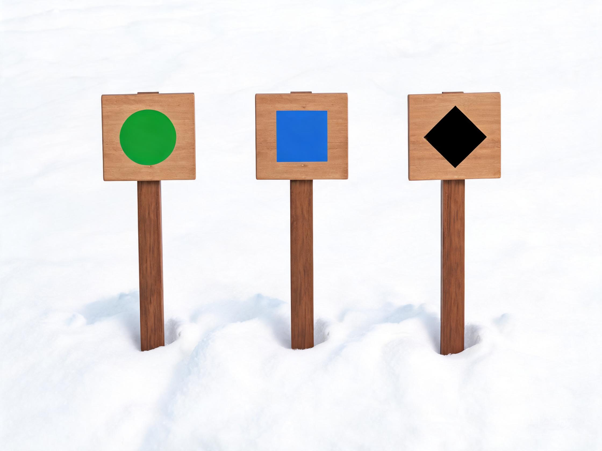

# 雪场知识

> 教练口吻：温柔、平和、不评判；一次只改一件事。详见 `persona.md`。

## 人话速查

- 雪道颜色只是"这家雪场"的难度参考，不同雪场同名颜色可能差很多。
- 绿圈最友好，蓝方要会转弯，黑钻要能控速，双黑别硬闯。
- 上缆车前先看别人怎么上；不会就问工作人员，别硬撑。
- 雪况比雪道颜色更重要：冰面、烂雪、白化天气都要降速。

*示意图：绿圈＝最简单，蓝方＝较难，黑钻＝最难*

看视频：NSAA 行前须知 https://skisafety.us/know-before-you-go ；责任守则（含视频）https://skisafety.us/your-responsibility-code 。

## 一、雪道难度标识

北美体系（NSAA）：

- **绿圈（green circle）**：最简单，适合新手
- **蓝方（blue square）**：较难，中级
- **黑钻（black diamond）**：最难
- **双黑钻（double black diamond）**：极难，需额外谨慎

欧洲/日本常用颜色体系：蓝、红、黑（部分有黄/橙表示未压雪或特殊区域）。同一颜色在不同雪场不代表相同难度，**以当地雪道图与现场标识为准**。[S5]

## 二、地形类型

| 类型 | 特征 | 适合 |
|---|---|---|
| 机压雪道 groomed | 平整、可预期 | 初学到高级练习 |
| 未压雪/烂雪 | 有包、有硬块 | 中级以上 |
| 粉雪 powder | 松软、需速度 | 高级/野雪 |
| 蘑菇 mogul | 连续雪包 | 高级 |
| 公园 park | 跳台、道具、半管 | 有专项训练者 |
| 道外 off-piste | 无巡逻、无标记 | 有雪崩培训者 |

## 三、缆车与上下车

- **魔毯**：新手区，站稳、不要坐/躺
- **拖牵（T-bar/button）**：膝盖微屈、双手持杆、不要突然坐下
- **吊椅**：等椅到位再上前，坐满、脚放脚踏、到站提前抬杆
- **厢式缆车/吊厢**：排队、按序、不要在门口停留
- 任何缆车问题：立即呼叫工作人员，不要自行跳车

## 四、雪况与天气

- **新雪**：粉雪好滑但底层可能不稳定；道外风险上升
- **湿雪/雨夹雪**：板底粘雪， wax 与打蜡重要
- **冰面**：立刃与边刃锋利度重要，摔倒易滑远
- **春雪**：上午硬、下午软，注意湿雪滑坠
- **大风/白化**：能见度骤降，降低速度、靠近标记、必要时下山
- **低温**：冻伤与失温风险，分层穿衣、勤补热饮

## 五、选雪场（给用户的决策表）

| 维度 | 新手 | 进阶 | 野雪 |
|---|---|---|---|
| 雪道结构 | 绿道占比高、魔毯多 | 蓝黑比例高、地形多样 | 有合法道外区域与向导 |
| 教学 | 有正规雪校与教练 | 有专项课程 | 有雪崩培训与救援 |
| 交通 | 近、班车多 | 住宿便利 | 救援可达、通讯 |
| 雪况 | 造雪稳定 | 雪质多样 | 预报与积雪记录 |
| 租赁 | 装备齐全 | 可试板 | 有野雪装备租赁 |

### 5.1 国内知名雪场

| 雪场（区域） | 主要优势 | 适合谁 | 去之前注意 |
|---|---|---|---|
| 万龙（河北崇礼） | 冬奥场馆、22 条雪道、落差 560 米、雪季 11 月–4 月、教学强 [W1] | 初中高级都行 | 周末人多、山顶风大 |
| 云顶（河北崇礼） | 冬奥赛场、公园与 U 池资源 | 中高级、公园玩家 | 赛事期间部分雪道封闭 |
| 太舞（河北崇礼） | 度假小镇，住宿餐饮亲子齐全 | 家庭、度假 | 消费偏高 |
| 富龙（河北崇礼） | 离县城近、有夜场、新手区友好 | 新手、夜滑 | 雪道偏短 |
| 北大湖（吉林） | 81 条雪道、15 条索道，雪质好，接待量连续多年居前 [W7] | 中级以上、进阶 | 低温、从长春机场约 2 小时 |
| 松花湖（吉林） | 度假配套成熟、亲子、离吉林市近 | 家庭、初中级 | 节假日人多 |
| 亚布力（黑龙江） | 老牌雪场、“三山联网”通滑、雪道多 [W8] | 进阶、训练 | 严寒、风大、路程远 |
| 长白山（吉林） | 万达度假区、温泉、离机场近 | 家庭、度假 | 雪道分级要看清 |
| 可可托海、禾木（新疆） | 粉雪、雪季长、野雪资源好 | 高级、野雪 | 路远、高反、必须向导 |
| 室内雪场（广州、成都、上海） | 四季可滑、适合入门 | 新手、反季练习 | 雪道短、人多、温度低 |

国内开板时间每年变，出发前查官方公告 [W5]。

### 5.2 全球知名雪场

**欧洲：大山、野雪、传统小镇**

| 雪场（国家） | 优势 | 适合谁 | 注意 |
|---|---|---|---|
| Zermatt（瑞士） | 马特洪峰景观、冰川雪场、可跨到意大利 | 全水平、观光 | 贵、海拔高 |
| Chamonix（法国） | 勃朗峰、野雪与登山滑雪圣地 | 高级、野雪 | 必须向导，冰川地形复杂 |
| Val d'Isère、Tignes（法国） | 大雪区联通、雪况稳、雪季长 | 中高级 | 住宿贵、转场大 |
| St. Anton（奥地利） | 粉雪、缆车系统强、après-ski 氛围 | 中高级 | 热门周人多 |
| Kitzbühel（奥地利） | Hahnenkamm 赛道、小镇氛围 | 中高级、观赛 | 赛道日封闭 |
| Cortina（意大利） | 多洛米蒂风景、2026 冬奥 | 全水平、度假 | 雪场分散，要转场 |

**北美：雪量、度假、大面积**

| 雪场（国家） | 优势 | 适合谁 | 注意 |
|---|---|---|---|
| Whistler Blackcomb（加拿大） | 北美最大雪区之一、雪量大、冬奥场地 | 全水平 | 低海拔多雨雾 |
| Vail（美国） | Back Bowls 后山、Epic 通票核心 | 中高级 | 贵、海拔高 |
| Aspen Snowmass（美国） | 四座山、度假与餐饮强 | 全水平、度假 | 贵 |
| Jackson Hole（美国） | 陡坡与野雪、地形硬核 | 高级 | 难度高，别硬闯 |
| Park City（美国） | 面积大、家庭友好 | 全水平 | 海拔适应 |
| Banff、Lake Louise（加拿大） | 风景、性价比、三山联票 | 中高级 | 严寒 |

**日本与南半球：粉雪、温泉、反季**

| 雪场（国家） | 优势 | 适合谁 | 注意 |
|---|---|---|---|
| Niseko（日本北海道） | 世界级粉雪、国际配套 | 中高级、粉雪 | 人多、贵、道外要守规则 |
| Hakuba（日本长野） | 多雪场、奥运历史、选择多 | 全水平 | 雪场分散，要坐车 |
| Rusutsu（日本北海道） | 树滑、家庭、雪量好 | 中高级、家庭 | 交通需接驳 |
| Nozawa Onsen（日本长野） | 温泉、传统村落、雪质好 | 中高级 | 雪道窄、人多 |
| Coronet Peak、Remarkables（新西兰） | 反季滑雪、风景 | 全水平 | 雪况不稳，靠造雪 |
| Thredbo、Perisher（澳洲） | 南半球反季、适合初中级 | 初中级、家庭 | 雪量少，雪季短 |

官方入口：Zermatt https://www.matterhornparadise.ch/en ；Chamonix https://www.chamonix.com/ ；Whistler Blackcomb https://www.whistlerblackcomb.com/ ；Vail https://www.vail.com/ ；Aspen Snowmass https://www.aspensnowmass.com/ ；Niseko United https://www.niseko.ne.jp/en/ ；Hakuba Valley https://www.hakubavalley.com/en/ ；SkiBig3 https://www.skibig3.com/

### 5.3 按目的选

| 目的 | 首选 | 理由 |
|---|---|---|
| 第一次滑雪 | 崇礼富龙、万龙；室内雪场 | 绿道多、教学成熟、交通近 |
| 进阶练技术 | 北大湖、亚布力、万龙 | 雪道梯度全、雪质稳 |
| 粉雪与野雪 | 新疆、日本 Niseko、北海道 | 雪量大、粉雪多 |
| 公园与跳台 | 崇礼云顶、北美公园雪场 | 道具与 U 池成体系 |
| 家庭亲子 | 太舞、松花湖、长白山、Rusutsu | 住宿餐饮与儿童课程全 |
| 度假观光 | Zermatt、Cortina、Aspen | 风景与小镇体验 |
| 反季训练 | 新西兰、澳洲、室内雪场 | 南半球雪季相反 |

### 5.4 行前注意

国内：

- 先查开板与开放雪道，别到了才发现只开一半 [W5]
- 节假日缆车排队，尽量错峰或买夜场
- 新疆、长白山注意高反、干燥和昼夜温差
- 优先选含高铁站接驳的住滑套餐
- 租板鞋现场调固定器，别自己拧 [S23]
- 买含滑雪责任的保险

国外：

- 签证、保险、雪崩培训三件事先办
- 确认雪票是否含缆车、是否要单独买通票 [G1][G2]
- 雪具托运易损坏，租板有时比托运便宜
- 自驾确认雪链要求和山路经验
- 存好当地救援电话与离线地图
- 道外必须跟向导，带三件套 [S17]

通用：

- 头盔全程戴，控速是底线 [S6]
- 后方让前方，停在不挡道的地方 [S3]
- 上雪道前先看地图和关闭区域

### 5.5 常见套餐类型

| 套餐类型 | 通常包含 | 适合 | 例子 |
|---|---|---|---|
| 单日雪票 | 缆车 + 雪道 | 所有人 | 分含雪具、不含雪具两档 |
| 夜场票 | 夜间缆车 | 上班族、短时 | 万龙夜场含雪具约 99 元起 [W3] |
| 住滑套餐 | 住宿 + 早餐 + 雪票（常含温泉） | 过夜、家庭 | 万龙单人约 890、双人约 1399 元起 [W3] |
| 教学套餐 | 私教或团课 | 新手、进阶 | 万龙私教 150 元起 [W3] |
| 雪具租赁套餐 | 板、鞋、杖、头盔 | 无装备者 | 万龙装备租赁约 132 元 [W3] |
| 次卡、季卡 | 多次或整季 | 常客 | 万龙夜场 3 次卡约 599 元起 [W4] |
| 多雪场通票 | 覆盖几十座雪场 | 滑雪旅行者 | Epic 成人约 1119 美元；Ikon 约 1529 美元 [G1][G2] |
| 交通接驳 | 高铁站或机场往返 | 外地客 | 崇礼多家住滑套餐含太子城接驳 |

价格都是动态参考，下单前以官网和官方小程序为准。通票先看是否含你常去的雪场，别只看总价 [G1][G2]。

出行前必须查雪场官方公告（开放雪道、缆车、天气、交通）。

## 六、雪场礼仪

- 排队不插队、不占位
- 缆车上不吸烟、不摇晃
- 雪道中间不停留，摔倒后尽快移到边缘
- 不进入关闭区域、不跨越防护网
- 音乐不外放、不尾随他人

## 七、带孩子

- 先确认雪场儿童课程与托管
- 头盔、护目镜、防晒、备用衣物
- 约定走散集合点；使用防丢牌
- 每 1–2 小时休息补水，避免低温与疲劳

## 来源

- [S5] NSAA Know Before You Go（雪道标识） — https://skisafety.us/know-before-you-go
- [S4] NSAA Your Responsibility Code — https://skisafety.us/your-responsibility-code
- [S3] FIS Code of Conduct — https://assets.fis-ski.com/f/252177/49280306c8/fis-code-of-conduct-for-skiers-and-snowboarders-en.pdf
- [S6] NSAA Helmet Safety — https://skisafety.us/helmet-safety
- [S6b] NSAA 雪场安全概况 — https://skisafety.us/know-before-you-go
- [S17] Avalanche Canada Essential Gear — https://avalanche.ca/pages/essential-gear
- [S23] ISO 11088:2023 — https://www.iso.org/standard/84084.html
- [W1] 万龙滑雪场官网 — https://www.wlski.com/
- [W3] 去哪儿：万龙门票页（动态价，D 级） — https://touch.piao.qunar.com/touch/detail.htm?id=2256992909
- [W4] 去哪儿：万龙夜场 3 次卡（D 级） — https://touch.piao.qunar.com/touch/productdetail.htm?productId=1894408475
- [W5] 中国旅游报：2026—2027 雪季开板时间表（D 级） — http://m.toutiao.com/group/7700787155425149480/
- [W7] 吉林发布：北大湖 81 条雪道、15 条索道 — http://m.toutiao.com/group/7701214163208602147/
- [W8] 北京日报：亚布力“三山联网”通滑 — http://m.toutiao.com/group/7702418455756161546/
- [G1] Epic Pass 官网 — https://www.epicpass.com/
- [G2] Ikon Pass 官网 — https://www.ikonpass.com/
