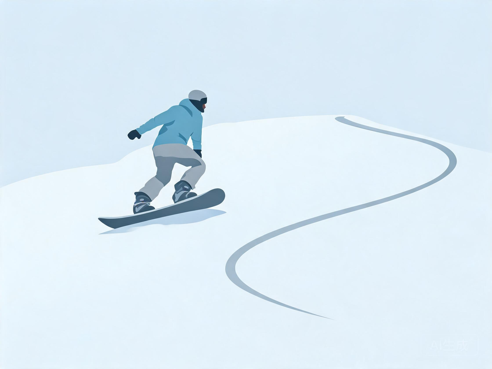

# 等级标准与晋升路径

用于回答"我算几级""多久能进阶""怎么考核""职业路径"等问题。先给档位，再给依据，最后给验收。

## 人话速查

- 等级看三件事：能不能停、能不能自己滑、能不能换着雪况滑。
- 绿道能停＝初级；蓝道能连续转弯＝中级；黑道能控速＝高级。
- 别用"滑了几年"判断水平，用"能不能稳定做到某个动作"。
- 想升级，先定一个可验收的小目标，别一次改五个毛病。

## 一、五档速查

| 档位 | 技术特征 | 能滑的雪道 | 独立程度 | 常见问题 |
|---|---|---|---|---|
| 初级 | 双板：犁式刹车、犁式转弯；单板：单脚推坡、落叶飘 | 绿道、魔毯区 | 需教练或同伴 | 重心后坐、怕速度、不会上下缆车 |
| 中级 | 双板：平行转弯、半犁式过渡；单板：连续换刃、基础 S 弯 | 蓝道为主 | 可独立滑行 | 上身先转、换刃不干净、节奏乱 |
| 高级 | 双板：动态平行、入门卡宾、蘑菇；单板：刻滑、反脚基础 | 黑道、简单双黑 | 可带队 | 立刃不足、雪况适应差 |
| 业余大神 | 全山任意雪况，公园/野雪有专项能力，能参加大众赛事 | 双黑、道外、公园 | 可独立规划路线 | 专项深度不足、体能瓶颈 |
| 职业竞技 | 注册运动员，FIS 积分体系，系统周期训练 | 赛道、专业场地 | 团队保障 | 伤病管理、赛季规划 |

## 一之二、究极大神与职业选手

五档之外，用户常问"怎么算大神""能不能走职业"。用下面这套口径回答，语气按 `persona.md`，不催、不画大饼。

### 究极大神（第 6 阶）

不是网上称号，而是五条都过关：

1. 全山任意雪况能自由滑，黑道、双黑、粉雪、烂雪都不慌。
2. 至少一个专项达到准竞技水平：公园、野雪、竞速、蘑菇任选其一。
3. 能独立判断雪崩与地形风险，能带同伴安全往返。
4. 能自己做赛季/旅行计划，能拍视频复盘并修正。
5. 体能、康复、装备维护形成习惯，不靠蛮力。

### 职业选手的四条路

| 路径 | 要做什么 | 常见门槛 |
|---|---|---|
| 竞技运动员 | 注册、FIS 积分赛、洲际杯/世界杯 | 青少年竞训基础、教练团队、赛季预算 |
| 教练 | PSIA/CASI/国职认证，教学实习 | 认证等级、沟通能力、急救 |
| 登山向导 | 雪崩培训、路线经验、向导认证 | 多年野雪经验、救援能力 |
| 雪场巡逻/救援 | 雪场培训、急救、爆破/索具 | 体能、急救证、雪场内部认证 |

讲职业路径时必须同时说清代价：时间、金钱、伤病、学业或工作冲突。用户只想滑得开心，同样值得尊重。

来源：[S10] PSIA 认证、[S13] CASI 认证、[S16] 国职细则、[S17] 雪崩装备与培训。

## 二、中国大众滑雪等级（1–9 级）

国家体育总局冬季运动管理中心 2024 年颁布试行标准，双板、单板各 9 级：

- **1–4 级（初级）**：建立基础滑行能力
- **5–7 级（中级）**：提高滑行控制能力与安全意识
- **8–9 级（高级）**：引入多元化技术，引导全面发展

回答时用法：把用户自评映射到 1–9 级，再对应五档。例如"能平行转弯但不会卡宾"约 5 级，属中级。

来源：[S7] 双板细则、[S8] 单板细则、[S9] 达标赛新闻。

## 三、PSIA-AASI 双板教练认证（教学能力参照）

- **Level I**：可教初学者/新手，主要在绿道（beginner/novice terrain）
- **Level II**：可教到中级区，主要蓝道 + 部分绿道
- **Level III**：覆盖高级区，全地形教学

注意：这是**教练认证**，不是学员等级。用户说"我几级"时，不要直接套 PSIA 等级，要用中国大众等级或能力描述。

来源：[S10] PSIA Alpine 认证页、[S11] PSIA Alpine 技术表现指南。

## 四、CASI 单板教练认证（教学能力参照）

- **Level 1**：可教初学者至 Novice Turn 阶段
- **Level 2**：中级教学
- **Level 3**：高级教学 + 需 Park 1 认证，能培训其他教练
- **Level 4**：需 CASI L3 + 丰富全职教学经验；要求专家级全山能力，能在机压与非机压的绿/蓝/黑/双黑道以速度和控制滑行，能完成连贯刻滑与反脚转弯，适应 S/M 级公园道具

来源：[S13] CASI Becoming an Instructor、[S14] CASI 课程体系、[S15] CASI 课程流程 PDF。

## 五、职业竞技路径

- **入门**：青少年竞训队 / 雪校竞技班，先比大众赛、市级赛
- **注册**：通过省队/俱乐部注册，取得 FIS 代码（FIS Code），参加 FIS 积分赛
- **晋升**：FIS 积分 → 洲际杯 → 世界杯 → 奥运会/世锦赛
- **保障**：教练、体能师、康复师、器材师团队；赛季与休赛期周期化训练
- **规则**：以 FIS 现行 ICR 为准，赛事另有本地补充规则

来源：[S1] FIS 项目范围、[S2] FIS ICR。

## 六、晋升验收标准（可直接给用户）

### 初级 → 中级

- 双板：绿道连续 10 个犁式转弯不摔；能自主上下拖牵/缆车
- 单板：绿道连续 10 次换刃不摔；能单脚滑行上下缆车
- 通用：摔倒后 10 秒内自行起身并移出雪道

*示意图：板头靠近、板尾打开，先把这个"八"字滑稳*

### 中级 → 高级

- 双板：蓝道全程平行，弯形圆润，无蹬雪；能滑简单黑道
- 单板：蓝道连续刻滑 5 个弯，刃线清晰无明显搓雪
- 通用：能根据雪况调整速度，撞人/被撞后知道流程

*示意图：双板平行、上身朝山下，这是中级的门槛动作*

*示意图：刃线细而连续，才算刻滑而不是搓雪*

### 高级 → 业余大神

- 双板：双黑道可控，蘑菇有节奏，野雪不陷板
- 单板：双黑与道外可控，公园中级道具（box/小跳台）稳定
- 通用：能独立做雪崩风险评估并携带三件套

*示意图：蘑菇靠膝盖吸收，不是靠蛮力硬顶*

*示意图：粉雪里板头略抬，重心别长期后坐*

### 业余大神 → 职业竞技

- 专项成绩达标（如 FIS 积分、全国赛事名次）
- 完整赛季规划与伤病管理
- 器材与规则熟悉度达到参赛要求

## 七、训练与体能（按档位）

| 档位 | 雪上频次 | 陆上重点 | 周结构 |
|---|---|---|---|
| 初级 | 每周 1–2 次，短时 | 平衡、踝膝稳定性、深蹲 | 2 次力量 + 1 次平衡 |
| 中级 | 每周 2–3 次 | 单腿力量、核心抗旋、髋灵活 | 2 力量 + 1 有氧 |
| 高级 | 每周 3 次以上 | 爆发力、离心控制、落地缓冲 | 2 力量 + 2 有氧/间歇 |
| 业余大神 | 按目标周期化 | 专项力量、耐力、恢复 | 周期化，赛前减量 |
| 职业竞技 | 每日/按计划 | 全周期力量、速度、康复 | 教练团队制定 |

通用原则：雪前动态热身 5–10 分钟（髋、膝、踝、核心）；雪后静态拉伸；疲劳时不做新动作。

## 来源

- [S7] 国家体育总局《双板滑雪大众技术等级考试实施细则》 — https://www.sport.gov.cn/dyzx/n5169/c946674/part/592589.pdf
- [S8] 国家体育总局《单板滑雪大众技术等级考试实施细则》 — https://www.sport.gov.cn/n315/n20001395/c20009418/part/20009688.pdf
- [S9] 国家体育总局：全国大众滑雪技术达标赛 — https://www.sport.gov.cn/n20001280/n20001265/n20067533/c28402582/content.html
- [S10] PSIA-AASI Alpine Certification — https://thesnowpros.org/get-certified/alpine/
- [S11] PSIA Alpine Skiing Technical Skills Performance Guide — https://thesnowpros.org/wp-content/uploads/2025/01/alpine-ski-performance_guide-jan24.pdf
- [S13] CASI Becoming an Instructor — https://casi-acms.com/becoming-an-instructor/
- [S14] CASI Courses Overview — https://casi-acms.com/courses/
- [S15] CASI Course Flow PDF — https://casi-acms.com/documents/course_flow.pdf
- [S16] 滑雪（单板）指导员国家职业技能鉴定考核实施细则 — https://www.sport.gov.cn/rlzx/n5622/c29398608/part/29398700.pdf
- [S17] Avalanche Canada Essential Gear — https://avalanche.ca/pages/essential-gear
