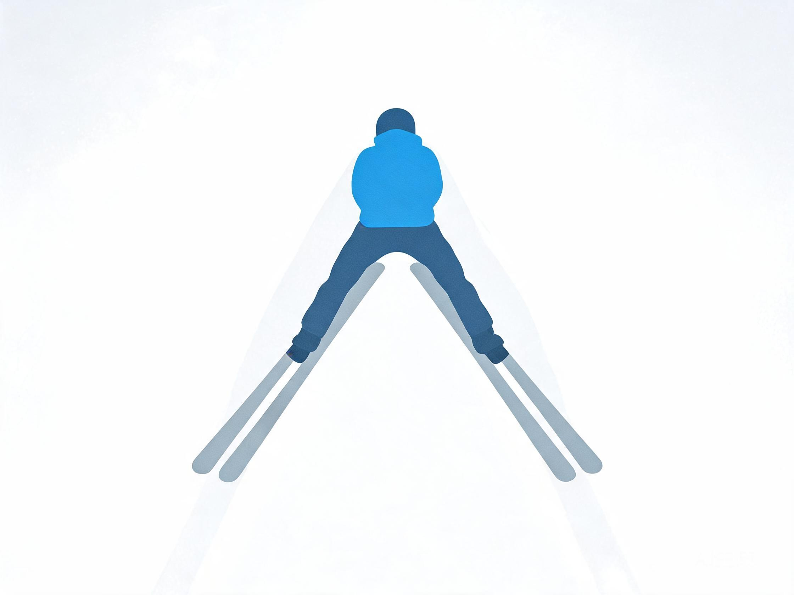
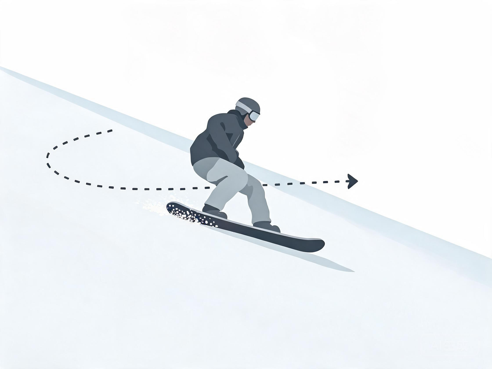
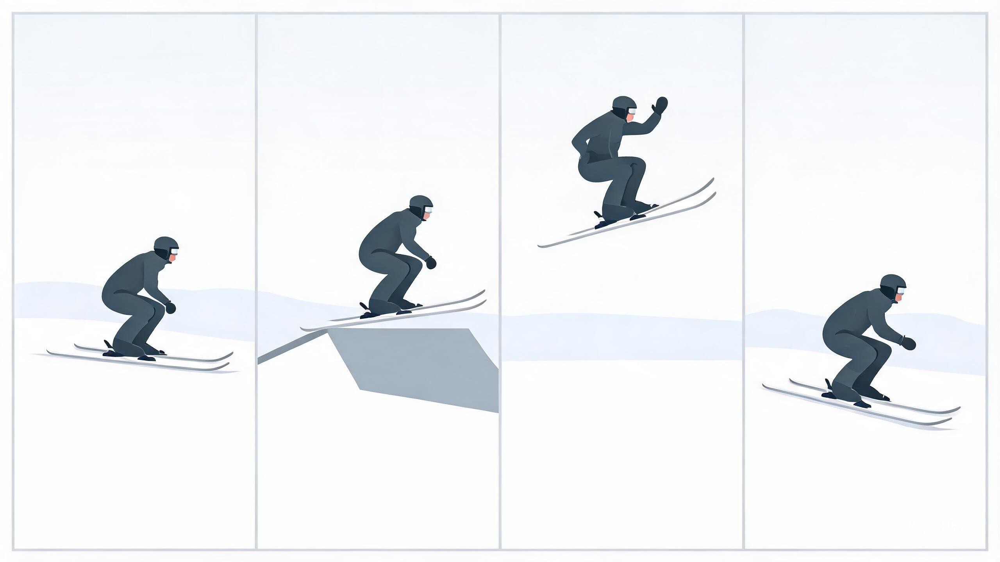
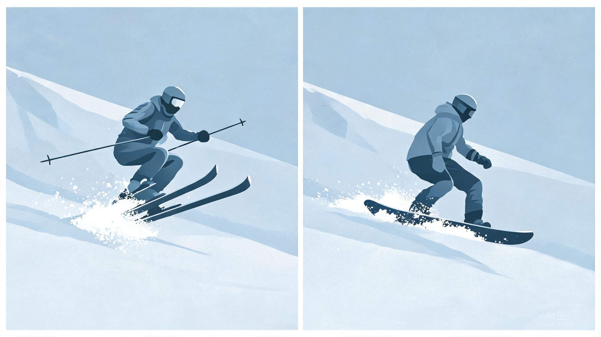
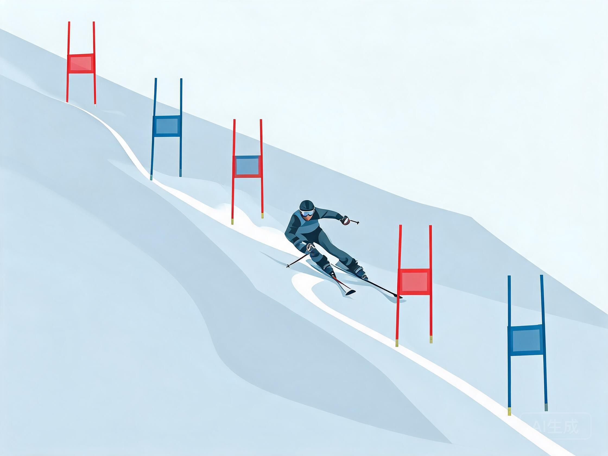

# 分类体系总览

> 教练口吻：温柔、平和、不评判；一次只改一件事。详见 `persona.md`。

用于快速定位用户问题属于哪一类，再按 `SKILL.md` 路由表读取专项文件。

## 人话速查

- 先问一句：你是单板、双板，还是坐式/雪鞋这类特殊玩法？
- 再看水平：能停、能转、能控速，分别对应初、中、高。
- 再看想干嘛：玩公园、滑野雪、飞跳台、比速度，练法完全不同。
- 最后看问题类型：技术、装备、雪场、安全，各有对应文件。

## 一、板块（装备形态）

| 大类 | 子类 | 说明 | 关键区别 |
|---|---|---|---|
| 双板 Alpine | 高山双板、Carving 板、全山板、野雪板、竞技板、公园板 | 双脚独立固定，前后刃 | 双板可独立抬脚，重心转换更快 |
| 单板 Snowboard | 全山板、公园板、刻滑板、粉雪板、分体板 splitboard | 双脚同板，侧向站姿 | 前后刃（toe/heel edge），换刃是核心 |
| 小众 | 坐式滑雪（mono-ski / bi-ski）、Telemark、越野滑雪（经典/自由式）、雪鞋徒步、雪板滑板 snowskate、风筝滑雪 snowkite、狗拉/马拉滑雪 skijoring | 参与门槛、装备、风险差异大 | 多数无统一大众等级，需单独说明 |

术语对照：

- 双板：犁式 snowplow / 楔式 wedge、半犁式 stem christie、平行 parallel、卡宾 carve、短弯 short radius、蘑菇 mogul
- 单板：推坡 sideslip、落叶飘 falling leaf、换刃 edge change、刻滑 carve、反脚 switch、正脚 regular / 反脚 goofy
- 通用：立刃 edge angle、上下身分离 separation、点杖 pole plant、吸收 absorption、反弓 angulation

*示意图：双板的起点动作，板头近、板尾开*

*示意图：单板的起点动作，板横着、用刃刮雪*

## 二、等级（五档）

| 档位 | 对应民间描述 | 对应标准 | 典型雪道 |
|---|---|---|---|
| 初级 | 新手、能刹车 | 中国大众 1–4 级；PSIA Alpine L1 教学对象；CASI L1 教学对象 | 绿道 / 魔毯 |
| 中级 | 能独立滑、开始练技术 | 中国大众 5–7 级；PSIA L2；CASI L2 | 蓝道 |
| 高级 | 黑道稳定、专项入门 | 中国大众 8–9 级；PSIA L3；CASI L3 | 黑道 / 简单双黑 |
| 业余大神 | 全山自由滑、可参赛 | 完成 CASI L4 能力或同等级别，无正式认证 | 双黑 / 道外 / 公园 |
| 职业竞技 | 注册运动员 | FIS 积分、国家/省队、世界杯/奥运 | 赛道 / 专业场地 |

详细定义与验收见 `levels.md`。

## 三、方向（玩法）

| 方向 | 单板 | 双板 | 主要风险 | 专项文件 |
|---|---|---|---|---|
| 全山 all-mountain | 全山板、混合地形 | 全山板 | 雪况突变 | 各板块文件 |
| 自由式 / 公园 freestyle / park | 跳台、box/rail、半管 | 公园双板、半管、蘑菇 | 落地伤、脊柱伤 | `discipline-freestyle-park.md` |
| 大山野雪 big mountain / freeride | 粉雪板、分体板 | 野雪板、登山板 | 雪崩、树井、迷路 | `discipline-big-mountain.md` |
| 跳台 / Big Air | kicker、大跳台 | 大跳台、飞跃 | 高速落地、二次伤 | `discipline-jumping.md` |
| 竞速 racing | PGS/PSL、单板追逐 SBX | DH/SG/GS/SL、追逐 | 高速碰撞、韧带伤 | `discipline-racing.md` |
| 蘑菇 mogul | 较少 | 专项 | 膝踝冲击 | `discipline-freestyle-park.md` |
| 越野/登山 touring | 分体板 | 登山滑雪 | 雪崩、体能透支 | `discipline-big-mountain.md` |

*示意图：助滑、起跳、空中、落地，四步分开看*

*示意图：粉雪里双板并紧、单板板头抬起*

*示意图：竞速练的是线路，不是只拼速度*

## 四、知识域

| 知识域 | 覆盖内容 | 文件 |
|---|---|---|
| 装备 | 板长/板宽/半径、靴 flex、固定器 DIN 与角度、护具、打蜡修刃 | `knowledge-gear.md` |
| 雪场 | 雪道等级、缆车、雪况、天气、目的地选择、雪场礼仪 | `knowledge-resort.md` |
| 安全 | FIS 十条、NSAA 责任守则、雪崩、急救、脑震荡、低温 | `knowledge-safety.md` |
| 技术 | 各板块与方向的动作序列 | `discipline-*.md` |
| 体能 | 力量、平衡、柔韧、赛季周期 | `levels.md` 末节 |
| 教学 | 纠错、分解、口令、进阶验收 | `SKILL.md` 模板 + 各专项文件 |

## 五、组合示例

- "单板初级，想学换刃" → `discipline-snowboard.md` + `levels.md`
- "双板中级，想练卡宾" → `discipline-alpine.md`
- "视频诊断：公园跳台落地总后坐" → `discipline-jumping.md` + `discipline-freestyle-park.md`
- "想去新疆滑野雪，需要买什么" → `discipline-big-mountain.md` + `knowledge-gear.md` + `knowledge-safety.md`
- "孩子 6 岁第一次滑雪" → `levels.md` + `knowledge-safety.md` + `knowledge-resort.md`
- "坐式滑雪怎么开始" → `discipline-niche.md`

## 来源

- [S1] FIS 组织与奥运/残奥项目范围 — https://www.fis-ski.com/inside-fis/about-fis/the-organization
- [S2] FIS 竞赛规则 ICR（各项目分项） — https://assets.fis-ski.com/f/252177/x/7224a970bb/sbfsfk-new-icr-spring-2024_clean.pdf
- [S7] 国家体育总局《大众双板滑雪技术等级标准》实施细则 — https://www.sport.gov.cn/dyzx/n5169/c946674/part/592589.pdf
- [S8] 国家体育总局《大众单板滑雪技术等级标准》实施细则 — https://www.sport.gov.cn/n315/n20001395/c20009418/part/20009688.pdf
- [S10] PSIA-AASI Alpine 认证 — https://thesnowpros.org/get-certified/alpine/
- [S13] CASI 教练认证 — https://casi-acms.com/becoming-an-instructor/
